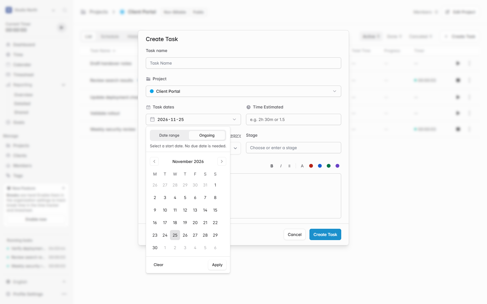

# Refine the project schedule and task date controls

## Why

The project schedule split frequently used controls across two rows and repeated equivalent dates. Empty timer cells added visual noise, and the date picker used a browser checkbox to switch between two scheduling modes. The sidebar also placed running tasks too close to account controls.

## Changes

- Put the project view selector, date navigation, and Create Task in a compact toolbar. Show dates and task categories beside task names, and display elapsed time only for started timer sessions in Schedule.
- Present Date range and Ongoing as explicit modes in the same date picker. Show a single date when the start and due dates coincide.
- Give running tasks and account settings separate sidebar sections. Keep Profile Settings as a direct link and provide logout through the account menu.

## Verification

Built the frontend and checked the local Solidtime preview with sample data. Verified the 14-day Schedule, date navigation, task details, List and History entry points, keyboard date-mode selection, running timers, and the account menu. Checked that the project view fits a narrower browser window.

## Screenshots

[Upstream Solidtime README](https://github.com/solidtime-io/solidtime#readme)
