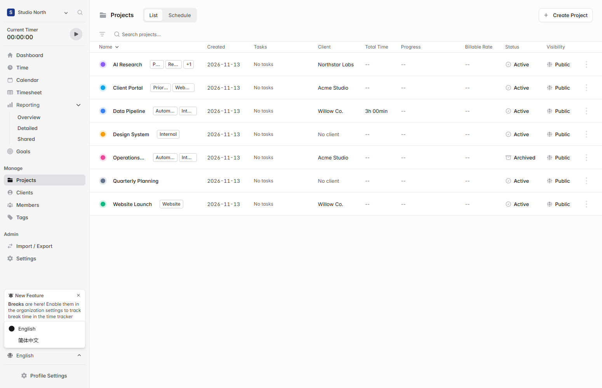
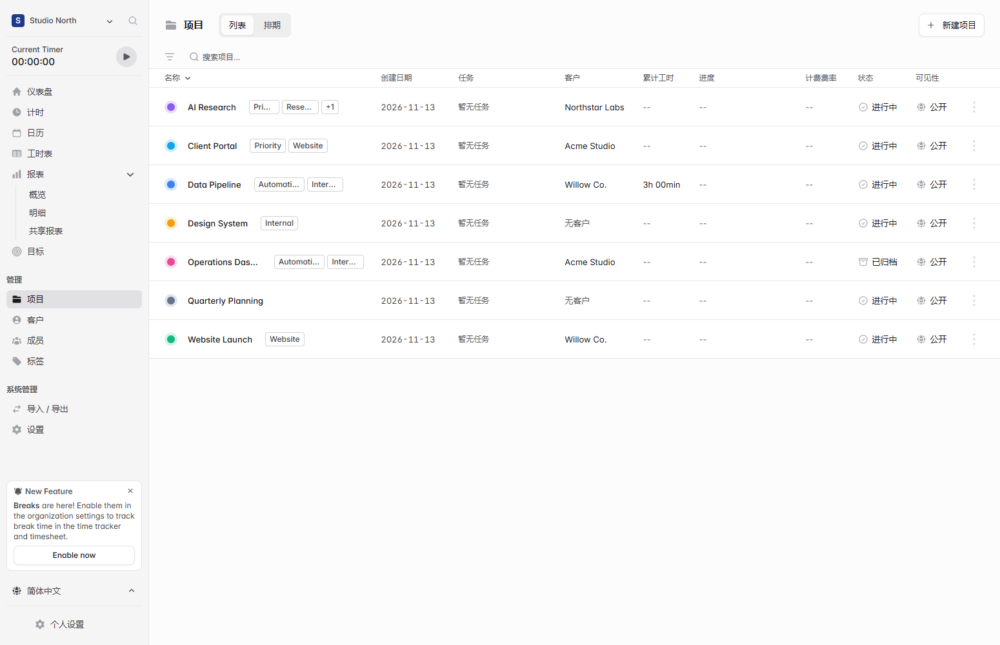

# Add a Simplified Chinese interface option

The language menu above Profile Settings switches between English and Simplified Chinese immediately and remembers the choice in the browser. This first pass translates sidebar navigation, the Projects list, and selected task and schedule labels. It preserves user-entered names and notes.

The frontend build and TypeScript check passed. Local browser verification covered switching both ways, retaining the preference across reloads, and preserving project names.

[Upstream Solidtime README](https://github.com/solidtime-io/solidtime#readme)
