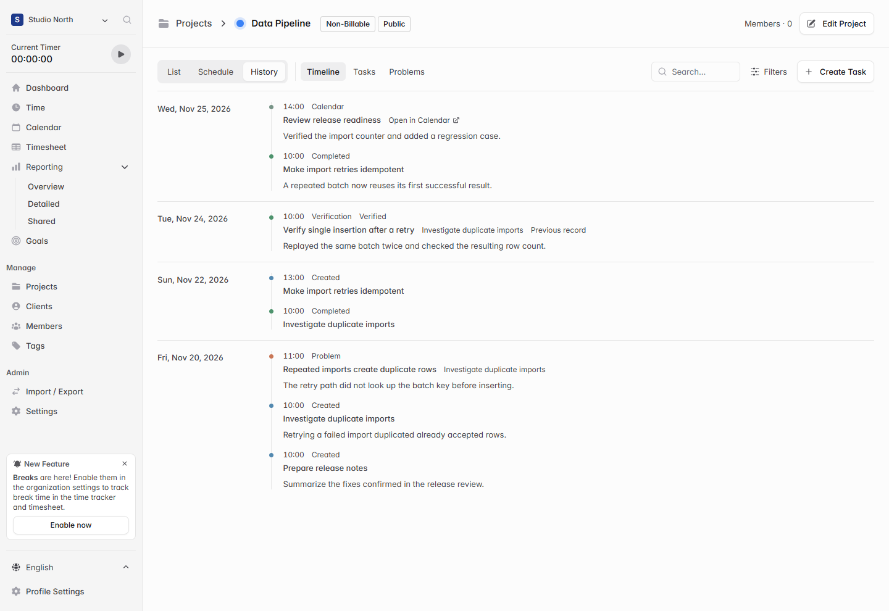
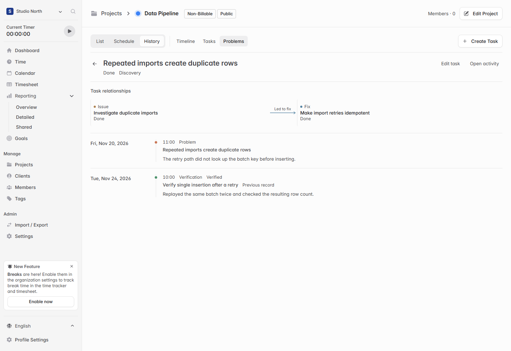
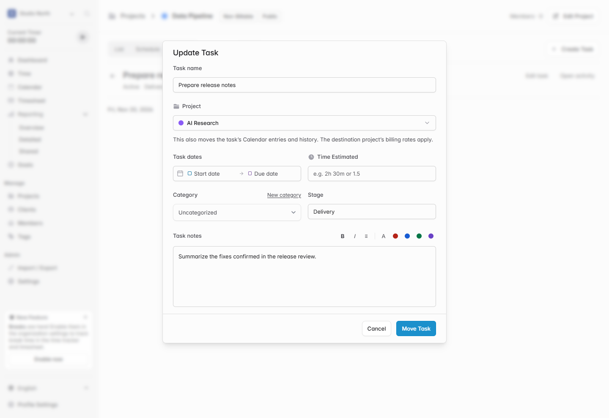

# Move tasks between projects and rebuild project History

Tasks created under the wrong project can now be moved from the existing edit form. Project History makes it easier to review what happened, locate a task, and follow a recorded problem through to its resolution.

## What changes

- Select another active project from the task edit form and choose **Move Task**. The task, its Calendar entries, and its History records retain their IDs and travel together. The destination's billing rates apply and both project totals are recalculated. The app checks destination permissions, duplicate names, existing task links, and unsaved timers before moving.
- **Timeline** displays dated task and Calendar activity, including project-level Calendar entries. **Tasks** is a searchable list with a detail view. **Problems** groups recorded issues with their updates and shows the existing task relationship graph.
- Desktop view switching, search, filters, and task creation share one toolbar. The filters menu contains stage, category, activity type, and sort order.

## Screenshots

## Verification

- Production frontend build, TypeScript checking, and frontend unit tests.
- Local browser checks for the desktop and mobile layouts, filter behavior, keyboard dismissal, task and problem detail, and the move request.
- PostgreSQL endpoint regressions for destination permissions, duplicate names, existing task links, active timers, and Calendar and History record readback after a move.

[Upstream Solidtime README](https://github.com/solidtime-io/solidtime/blob/main/README.md)
