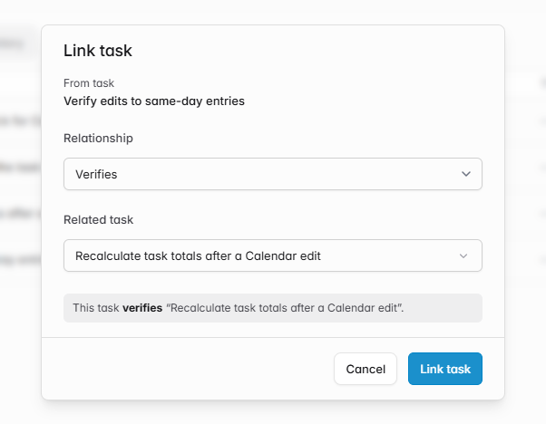
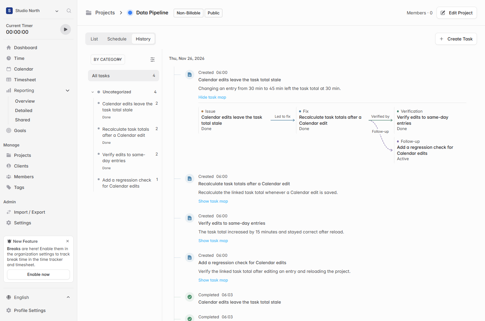

# Link project tasks and show their relationships in History

## What changes

- Choose **Link task** from a task's actions menu. Select a task in the same project and choose **Fixes**, **Verifies**, or **Follows up on**. The form previews the direction before saving.
- In project **History**, expand **Show task map** beneath a linked task's record. Solidtime draws the stored relationships inline, including follow-up branches. Selecting a node opens the existing task Activity panel.
- Open **Link task** again to remove an outgoing link. Repeated saves of the same link are idempotent. Project permissions, same-project validation, and cycle checks apply to relationship writes.

## Screenshots

## Verification

- Ran TypeScript checking and built the production frontend assets.
- Ran the Task Relationship and Task History endpoint tests against a separate local PostgreSQL test database. All 7 tests passed with 83 assertions.
- In a local Solidtime preview, created three links through the browser, read them back through the API, and expanded the graph before and after reloading. Checked task Activity, narrow-screen relationship labels, and unlinking.

[Upstream Solidtime README](https://github.com/solidtime-io/solidtime#readme)
