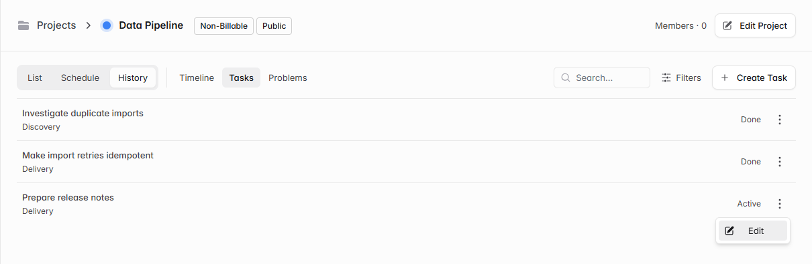
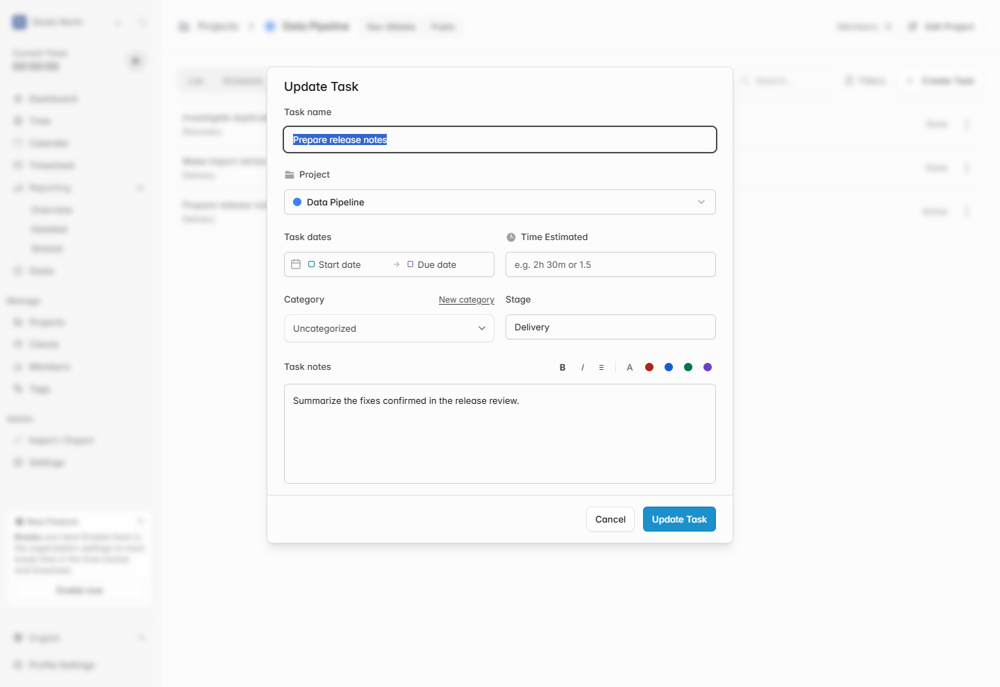

# Edit tasks directly from project History

Editing a task in the History Tasks list previously required opening its detail view. Each row now has a three-dot menu with an **Edit** action for members with task edit permission.

Selecting **Edit** opens the existing task editor in place. Selecting the task name opens its detail view.

## Screenshots

## Verification

- Checked the menu and editor in a local browser with sample data. Opening the menu with the keyboard exposes one Edit item. Canceling the editor returns to the list, and opening the task name still shows details.
- Ran the frontend build, TypeScript checking, and 230 frontend unit tests.

[Upstream Solidtime README](https://github.com/solidtime-io/solidtime/blob/main/README.md)
