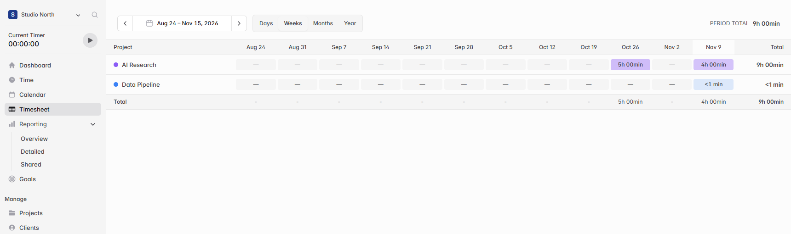
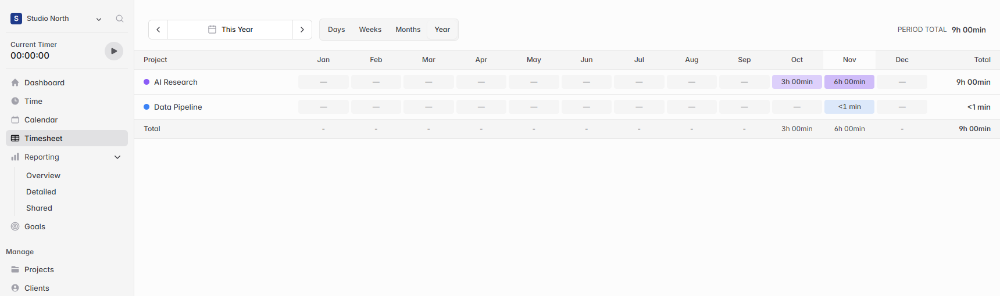
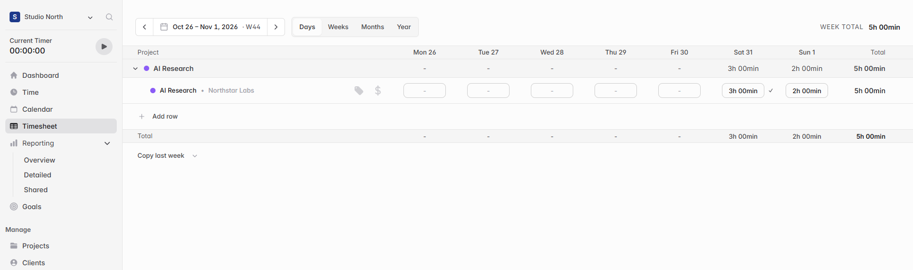

# Group Timesheet hours by project and show activity over time

When a project has several tasks, billable settings, or tags, its hours can be spread across several rows in the weekly Timesheet. I wanted to see how much time each project took this week and when work picked up or paused over a longer period.

## What changes

- **Days** shows a collapsible row for each project with daily hours and a weekly total. Expand a project to edit the existing task, billing, and tag rows.
- **Weeks** shows 12 weeks of actual hours by project. **Months** shows 12 rolling months, and **Year** shows January through December of the selected year.
- Colored cells show periods with tracked work. Gray cells show gaps. Select a month to see its weeks, then select a week to open the daily Timesheet with the project expanded.

## Verification

I checked the four views with sample time entries. A week spanning October and November shows only October hours when opened from October, and shows the full week in Days. I also verified that time can be edited and saved in the expanded daily rows. The production build and 52 existing Timesheet tests passed.

[Solidtime project README](https://github.com/solidtime-io/solidtime/blob/main/README.md)
