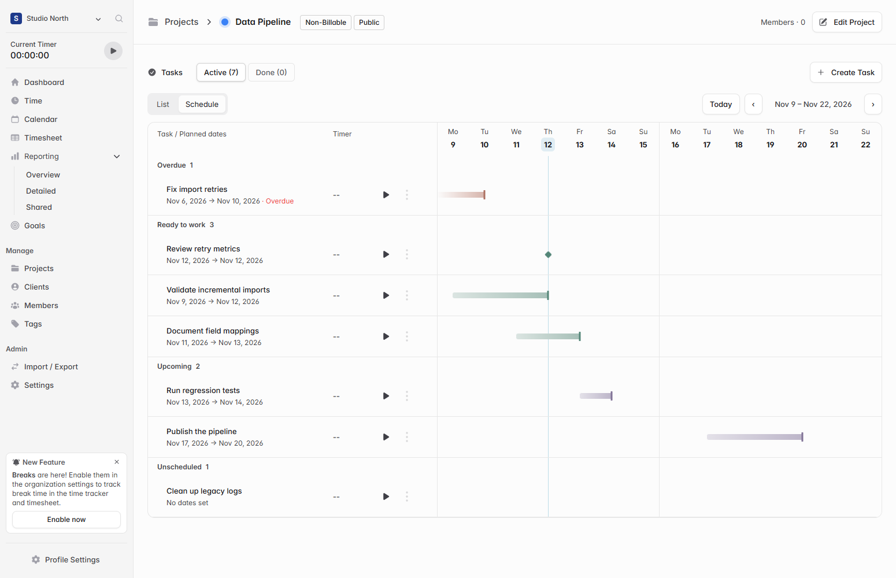
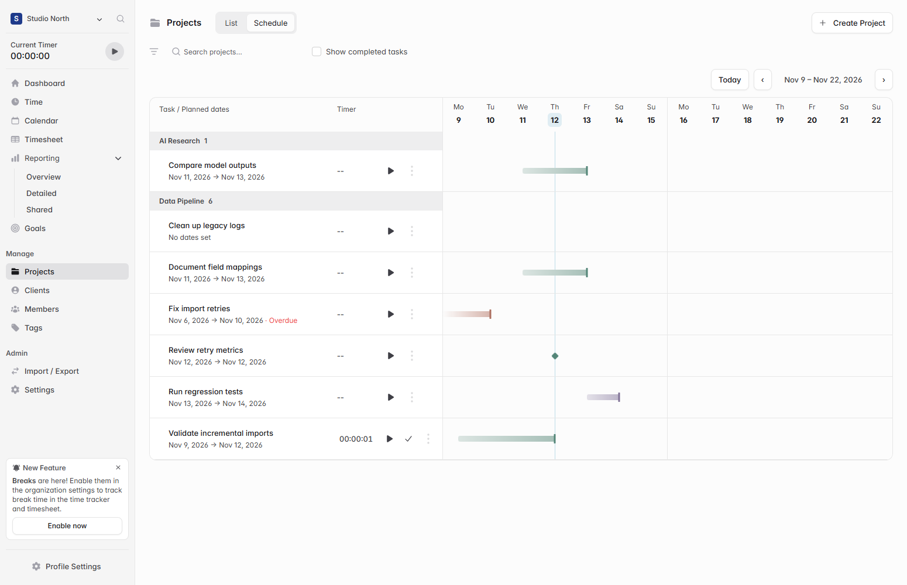

# Show a two-week schedule for project tasks

Project task lists show due dates, but it takes several rows to see what can be started now and how planned dates overlap. Open **Projects → a project → Active → Schedule** to see active tasks alongside a two-week timeline.

- Tasks are grouped by whether they are overdue, ready to work on, upcoming, or unscheduled.
- Gradient bars show planned ranges, with a tick on the deadline and a diamond for single-day deadlines.
- The timeline highlights today. Use the week arrows to browse and **Today** to return to the current week.
- The view reuses the existing task details, row actions, and timers. **List** opens by default.

Schedule shows this week and next week by default. A subtle line marks today, and overdue tasks carry a label. Timer controls remain available. The completed-task checkbox shows a focus ring during keyboard navigation.

## Verification

The two-week update passed the frontend build and local browser checks for 14 date columns, completed-task filtering, and timer actions.

Built the frontend and ran type checking and lint. Used Edge with the built assets and a local Solidtime API to check all four groups, gradient deadline alignment, week navigation, task details, the Done list, and starting and pausing a real test timer across the two views.

## Schedule across projects

Open **Projects → Schedule** to see tasks grouped by project on one two-week timeline. Project search and filters also apply in this view. Completed tasks are hidden by default. Select **Show completed tasks** next to project search to display them with a **Done** label. Tasks without dates remain listed under their project. A subtle tint highlights the current day. To open a single project directly in Schedule, use **Open Schedule** in its actions menu.

Edge verification with the local API covered two projects on the same timeline, the default and toggled completed-task filter, search filtering, the highlighted date, and switching between the overview, individual schedule, and List views.

[Upstream Solidtime README](https://github.com/solidtime-io/solidtime#readme)
