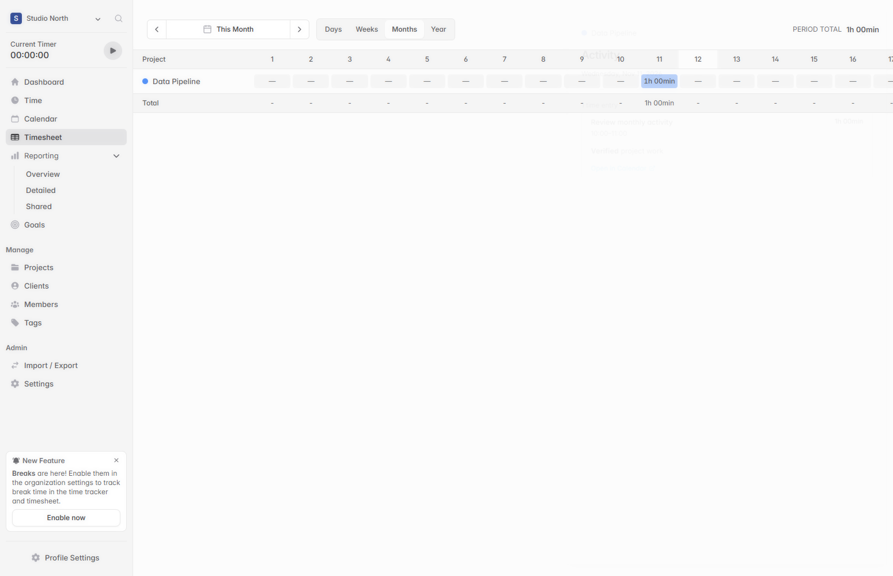
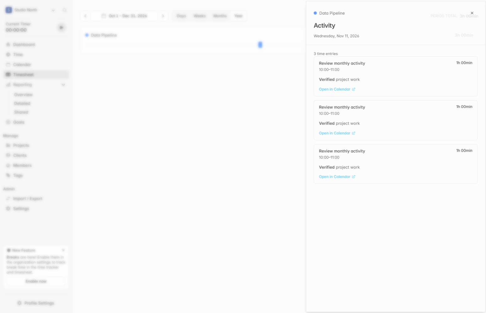

# Group Timesheet hours by project and show activity over time

When a project has several tasks, billable settings, or tags, its hours can be spread across several rows in the weekly Timesheet. I wanted to see how much time each project took this week and when work picked up or paused over a longer period.

## What changes

- **Days** shows a collapsible row for each project with daily hours and a weekly total. Expand a project to edit the existing task, billing, and tag rows.
- **Weeks** shows 12 weeks of actual hours by project. **Months** shows one calendar month with a column for each day, and **Year** shows daily activity as compact colored bars, three months at a time.
- The timeline takes inspiration from the [DeepSeek status page](https://status.deepseek.com/). Project-colored cells show periods with tracked work, and gray cells show periods with no recorded time. In **Weeks**, select a week to open the daily Timesheet with the project expanded. In **Months** and **Year**, select any date cell to open your Activity for that project and day, including time entries, Markdown notes, and links to Calendar.

Year loads only the displayed quarter and looks up each entry's date directly when aggregating time.

## Verification

The Year update passed the frontend build and TypeScript check. In Edge I verified 92 daily bars for the fourth quarter and opened the day's Activity with its recorded notes.

The monthly update was verified in Edge against a local Solidtime API, including November daily columns, populated and empty Activity drawers, Markdown notes, and the Year view. The production frontend build and TypeScript check passed.

I checked the four views with sample time entries. A week spanning October and November shows only October hours when opened from October, and shows the full week in Days. I also verified that time can be edited and saved in the expanded daily rows. The production build and 52 existing Timesheet tests passed.

[Solidtime project README](https://github.com/solidtime-io/solidtime/blob/main/README.md)
