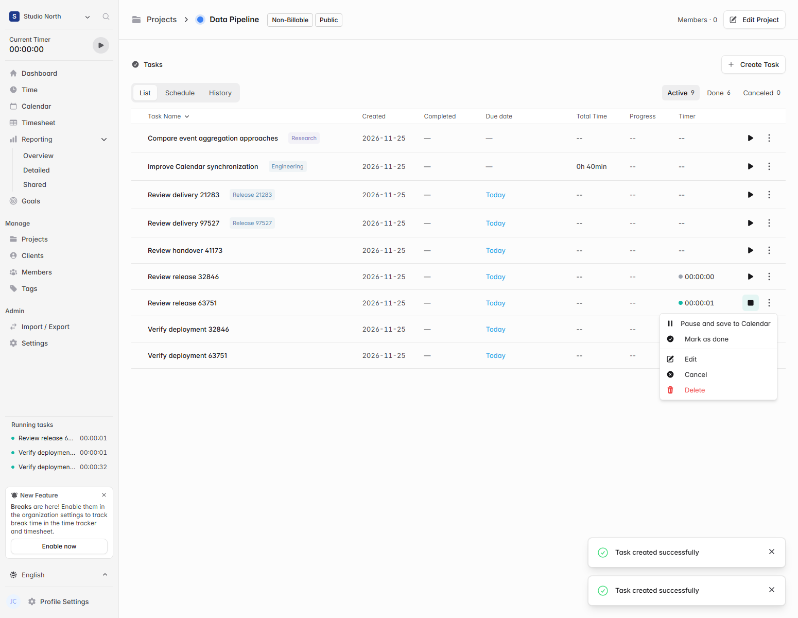

# Simplify project task and timer controls

Running task timers previously sat behind a collapsed row at the top of the sidebar. The project task toolbar also mixed view selection with status filters, and a running row exposed several equal-weight action buttons.

Running timers now appear in an expanded list below the sidebar navigation, with a task link and live duration. The project toolbar puts List, Schedule and History on the left and List status filters on the right. Schedule stays available when List is filtered to Done or Canceled. Each task row aligns a timer button and an actions menu. Pause and save to Calendar and Mark as done are available from that menu.

The Projects list puts tags in a dedicated column immediately before Created, keeping badges aligned across projects.

## Verification

The Vue type check and frontend build passed. In the local browser, two concurrent timers appeared together without expanding the sidebar. Stop, Pause and save to Calendar, and Mark as done worked from the updated controls. Switching between List, Schedule, and History preserved the List status selection.

The Projects list was checked in the browser for tag alignment, Created sorting, and horizontal scrolling at a narrow width.

[Upstream project README](https://github.com/solidtime-io/solidtime/blob/main/README.md)
