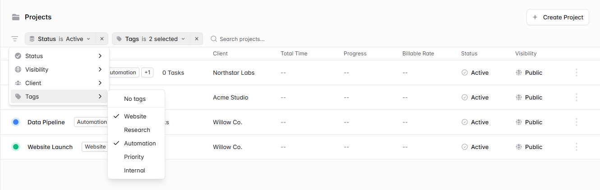
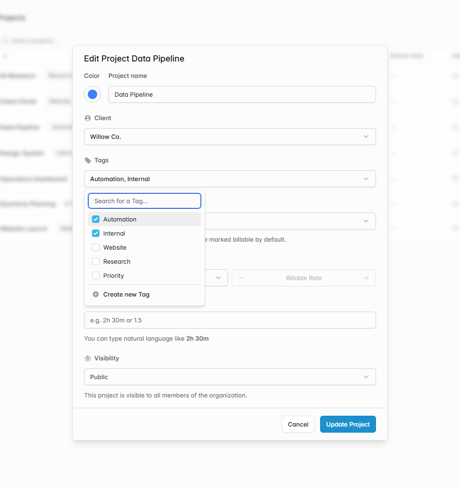

# Add project tags and filter the project list by tag

As my project list grows, I want to find related work across clients. For example, several clients can have automation projects, and I want to see all active automation projects together without having to look up each client.

Would you be open to adding tags to projects? I tried this in my self-hosted fork. When creating or editing a project, I can select multiple tags. The project list shows those tags next to the project name.

I added a **Tags** option below **Client** in the project filters. Selecting Automation and Website shows projects with either tag. I can also select Active to narrow the results or choose No tags to find projects I still need to categorize.

Would the existing project filter menu be a good home for this? I'd appreciate feedback on the multi-select behavior before preparing an upstream PR.

*Local preview with sample data.*

[Solidtime project README](https://github.com/Utoria-wu/solidtime/blob/main/README.md)
