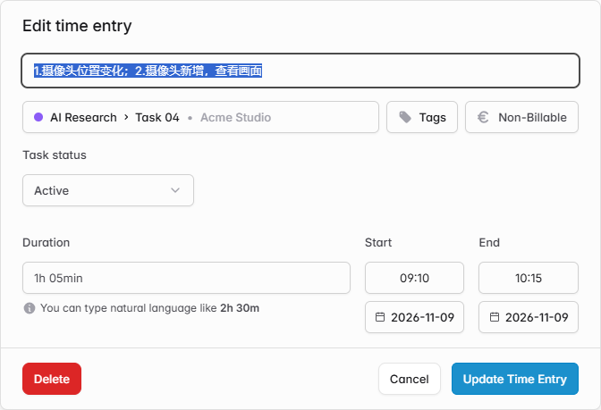

# Update linked task status when creating or editing a time entry

When I finish working on a task, I often update its time entry and then navigate to Projects separately to mark the task as done.

Would it make sense to add a “Task status” dropdown to the time entry creation and editing dialogs, including those opened from Calendar?

The proposed behavior would be:

- Show the linked task’s current Active / Done status.
- Let the user explicitly change it when saving the time entry.
- Hide the control when no task is selected or the user cannot update tasks.
- Leave the task unchanged when canceling or when its status was not edited.

This would update the linked task itself, rather than introduce a separate status for each time entry.

I have implemented this in my self-hosted fork. The screenshot shows the editing dialog.

Would this fit the product’s direction? I would appreciate feedback on the UI and expected behavior before preparing an upstream PR. Thanks.

[Solidtime project README](https://github.com/Utoria-wu/solidtime/blob/main/README.md)
