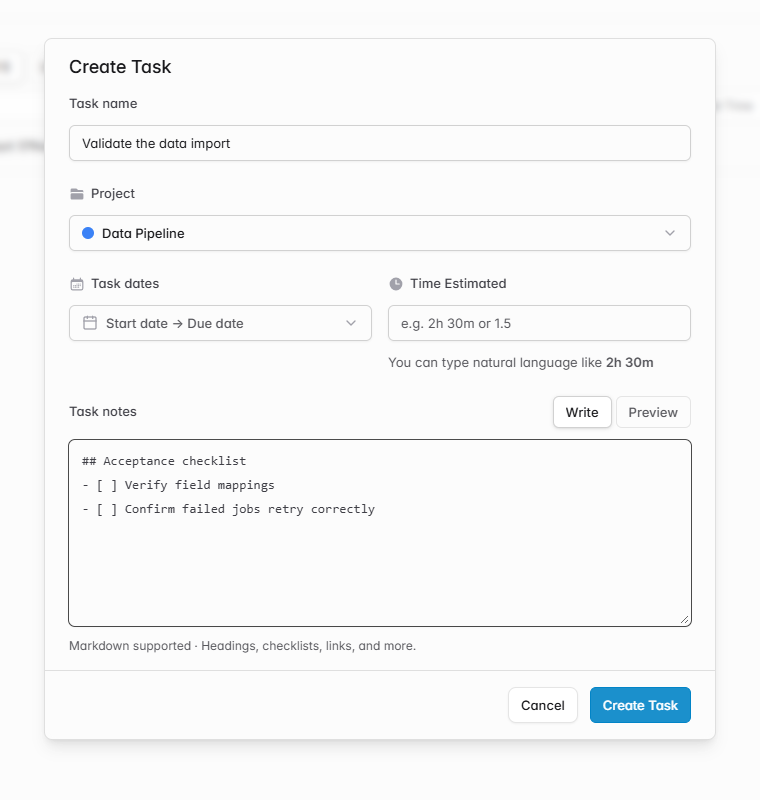

# Add Markdown notes to tasks

When creating a task, I want to keep its acceptance criteria and checklist in the task itself so I can revisit them while doing the work.

- Create and edit tasks with optional Markdown notes below the dates and estimate.
- Switch between Write and Preview to check headings, lists, and checkboxes.
- Keep these notes on the task, separate from the notes attached to individual time entries.

I verified creating a task with Markdown, editing it after a reload, and reading the edited text back. I also verified that a status-only update preserves the notes.

[Solidtime project README](https://github.com/solidtime-io/solidtime/blob/main/README.md)
