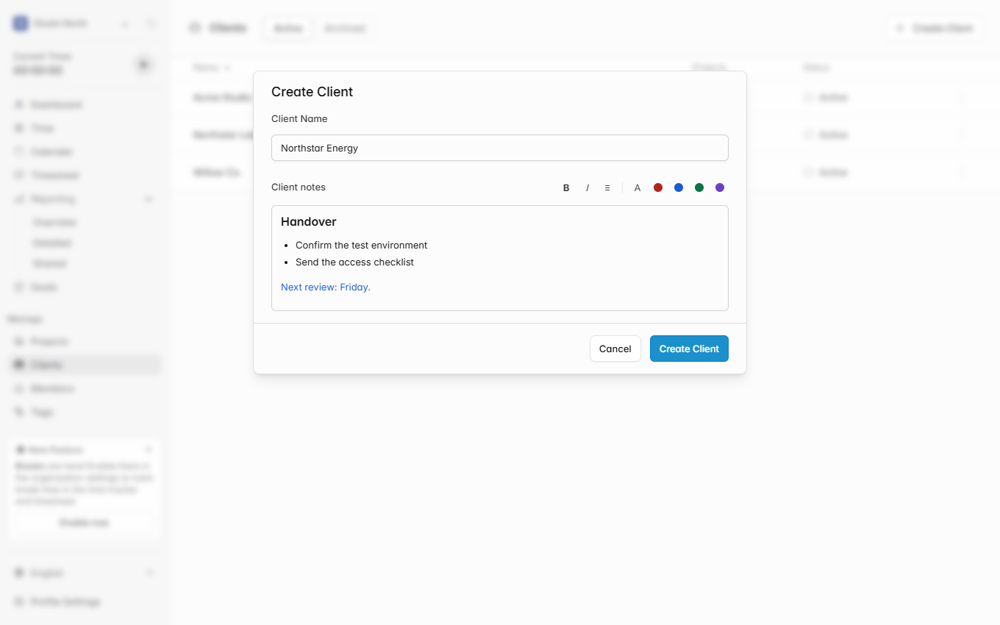
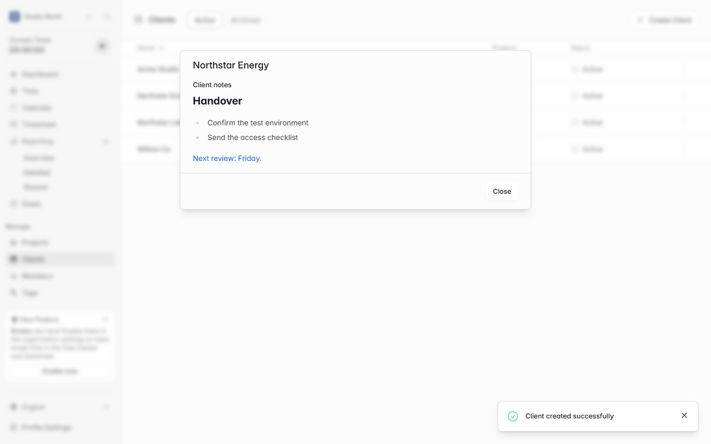

# Add Markdown notes to clients

## Why

Client records need a place for handover details and ongoing context that users can read without opening an edit form.

## Changes

- Add an optional Client notes field to the create and edit forms. It uses the same editor as task notes, including formatted text, Markdown paste, and text colors.
- Open saved notes by clicking a client name with a note marker in the Clients list.
- Store notes on the client record. Existing clients start with empty notes, and updates that omit the field preserve saved notes.

## Verification

Built the frontend and applied the migration to the local preview. Verified Markdown and color during creation and readback, editing, archiving, and clearing notes using sample data. The Client API suite passed all 22 tests.

## Screenshots

[Upstream Solidtime README](https://github.com/solidtime-io/solidtime#readme)
