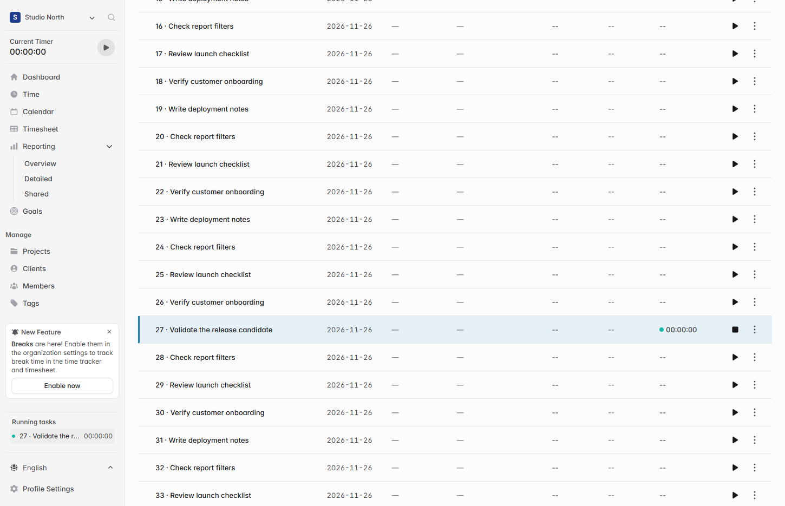

# Locate running tasks in their project

## Why

The Running tasks sidebar links to the project, but the user still has to find the running task in the list. That takes time when a project contains many similar rows.

## Changes

- Link each running task to its project with the task ID and open the corresponding task list.
- Scroll the target row into view, focus its task button, and briefly emphasize the entire row. A repeated click on the sidebar link highlights the task again.
- Use a temporary static highlight when reduced motion is enabled.

## Verification

Built the frontend and tested against the local Solidtime preview with 42 sample tasks. Verified cross-project navigation, correct row focus, repeated links from the same project, manual view changes, and reduced motion.

## Screenshot

[Upstream Solidtime README](https://github.com/solidtime-io/solidtime#readme)
