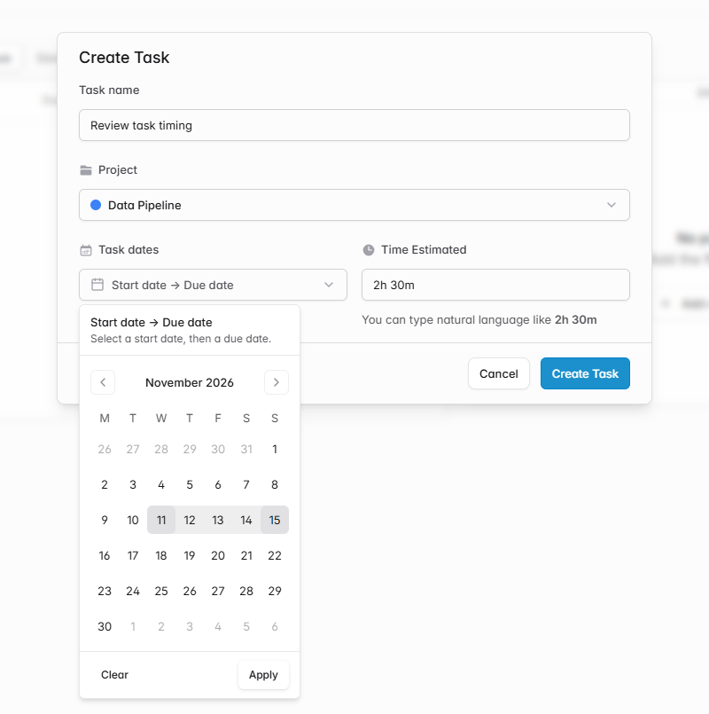
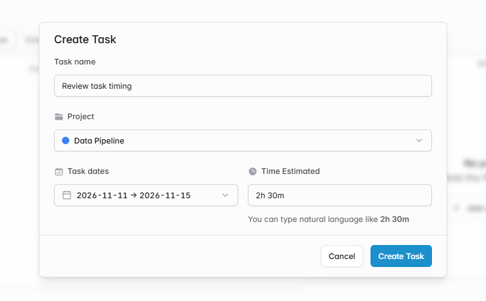
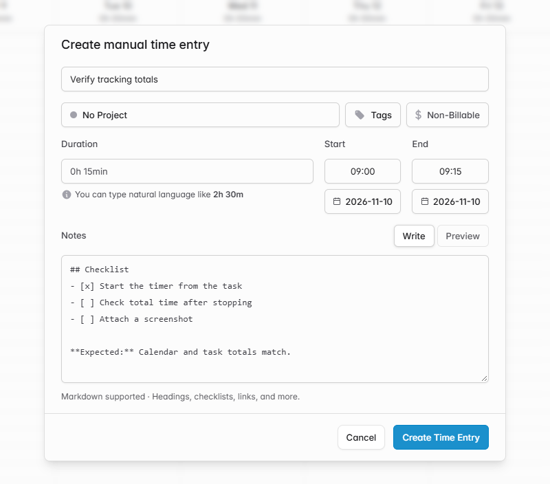
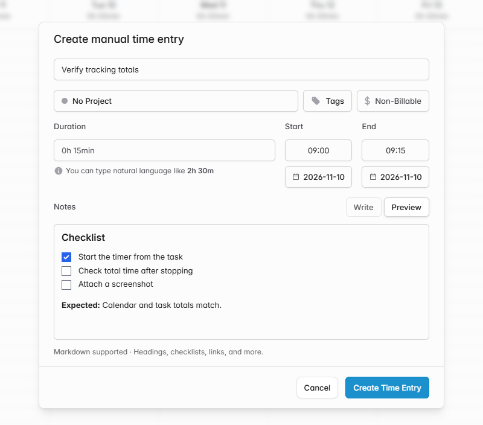

# Task date ranges and Markdown notes for Calendar entries

When I plan work in a project, I want to record when I expect to start and when it is due. When I log that work in Calendar, I want the event to keep a short title and still have room for a checklist or a few details.

## Task dates

In a project's task list, create or edit a task and open **Task dates** next to **Time Estimated**. Pick the start date and the due date in the same calendar, then click **Apply**. The date range is optional and can be removed with **Clear**.

The project task list has a sortable **Due date** column. Unfinished tasks due today show **Today**, and unfinished tasks past their due date show **Overdue**.

## Calendar notes

Create or edit a time entry in Calendar. Use **Write** for Markdown notes and **Preview** to check how headings, lists, checkboxes, links, and formatting will appear. The notes are saved separately from the event description, so the Calendar label can stay short.

The task name and manual time entry description fields also opt out of browser form autocomplete.

## Verification

The screenshots use a local demo with sample data. Browser testing covered creating a task date range, reopening it after reload, clearing it, and creating and editing a Calendar note. API tests cover invalid task ranges, preserving dates on status-only updates, and preserving and clearing Markdown independently of the event title.

[Solidtime project README](https://github.com/solidtime-io/solidtime/blob/main/README.md)
