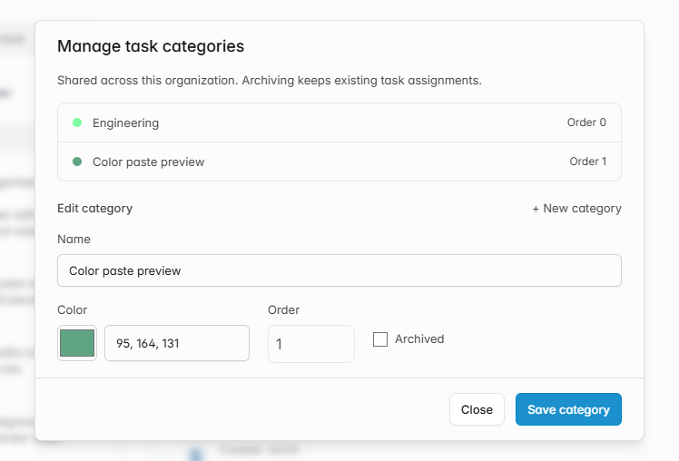

# Paste RGB or hex colors into task categories

The browser color picker shows individual RGB fields. This change adds a single Color input beside the swatch.

Paste a complete value such as `83, 137, 176`, `rgb(83, 137, 176)`, or `#5389B0`. The input replaces the current value and updates the swatch. Category saves use the existing six-digit hex format.

Verified in the local Solidtime browser with clipboard paste, swatch changes, invalid input, creating and editing a category, persistence after reload, and a narrow viewport. Type checking, linting the changed component, and the frontend build passed.

[Upstream Solidtime README](https://github.com/solidtime-io/solidtime#readme)
