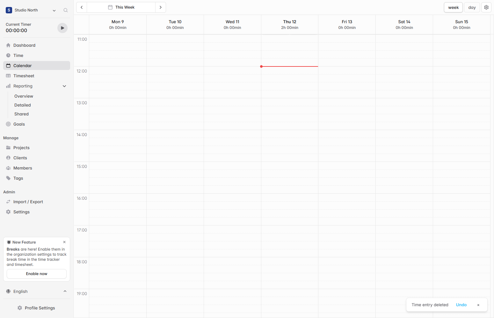
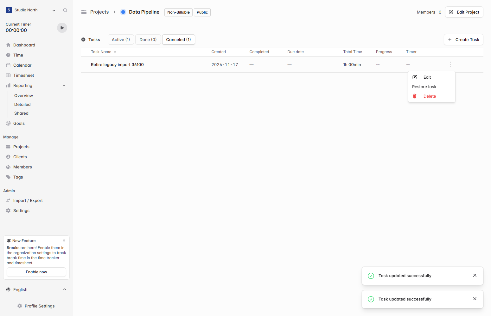
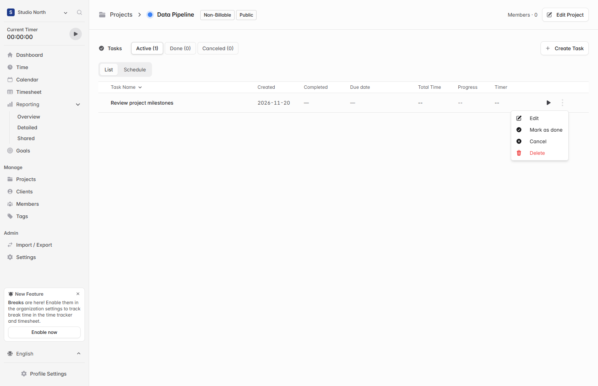

# Undo Calendar changes and cancel tasks

A mistaken Calendar edit or deletion can be reversed with **Undo** or **Ctrl+Z** (**Cmd+Z** on macOS). Undo restores the previous values or the original deleted entry and its task total. The latest eligible change is available while the Calendar page is open.

Canceled tasks have their own tab and are excluded from active work, the schedule, and project completion counts. Existing time entries remain available. Use **Restore task** to return a task to Active. Save any running or unsaved timer segments before canceling.

The task menu uses **Cancel** with a circle-cross icon aligned with the other actions. **Restore task** has a return-arrow icon.

## Verification

The updated Cancel label and icon were verified in a local browser using sample data. ESLint, formatting checks, and the production frontend build passed.

The local browser verified Ctrl+Z after editing and deleting a time entry, the original Calendar link after restoration, the resulting task total, and task cancellation and restoration.

[Upstream Solidtime README](https://github.com/solidtime-io/solidtime#readme)
