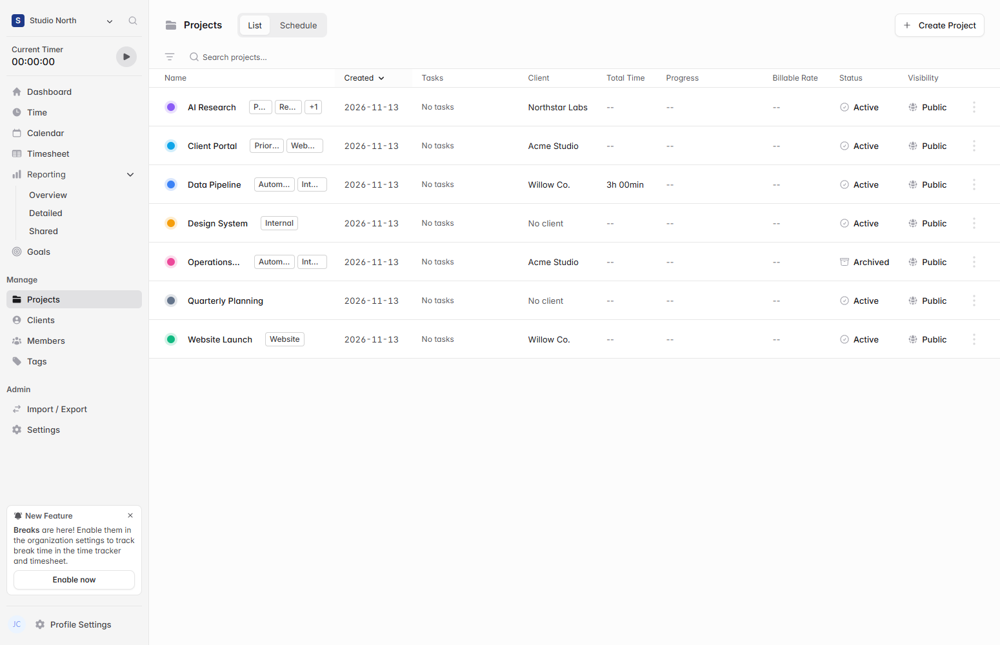
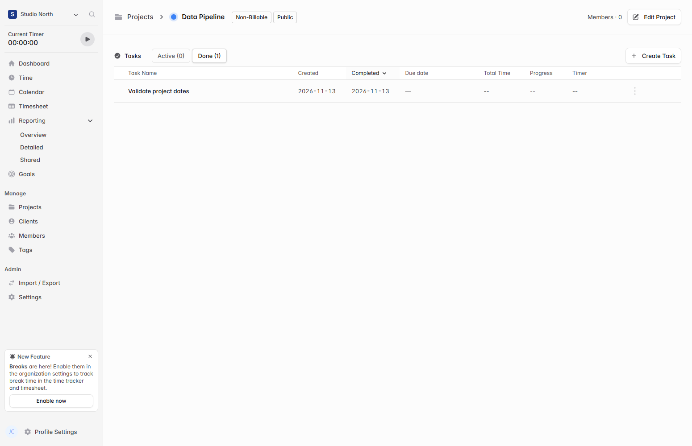
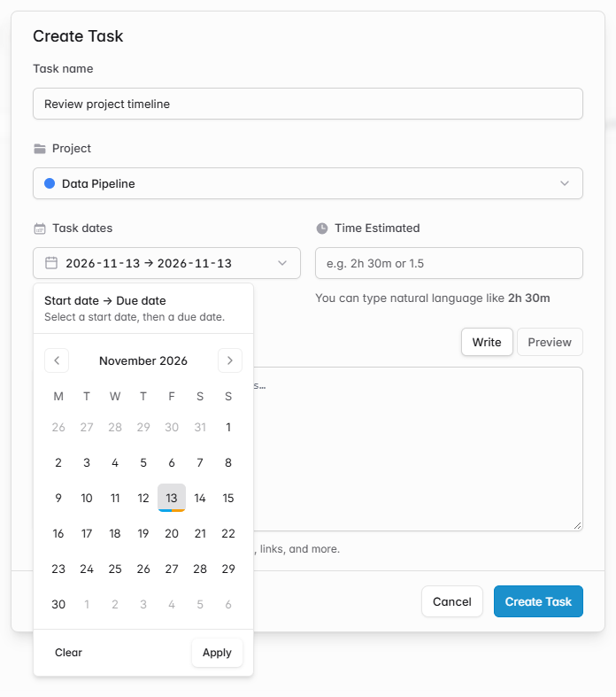
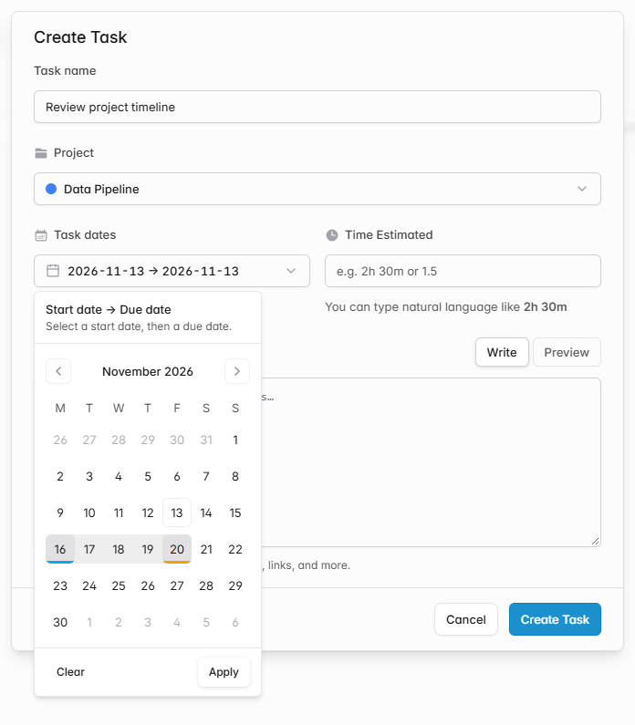

# Sort projects and tasks by creation and completion dates

When a workspace has many similarly named projects and tasks, names alone make it hard to find recent work. The Projects list now shows a sortable **Created** column. The task list adds sortable **Created** and **Completed** columns next to the existing planned due date. Clicking a date heading first sorts newest first.

Existing records use their stored timestamps. Reopening a task clears the completion timestamp, and marking an already completed task as done again preserves its timestamp.

New tasks start with both planned dates set to today in the user's time zone. The date picker marks the start in blue and the due date in amber, with both colors on a single-day range.

## Verification

The updated date picker was checked in Edge with the default day and with a multi-day range.

The frontend build and TypeScript check passed. A local browser and API check verified project and task timestamps, both list views, sorting controls, repeated completion, and reopening.

[Upstream Solidtime README](https://github.com/solidtime-io/solidtime#readme)
