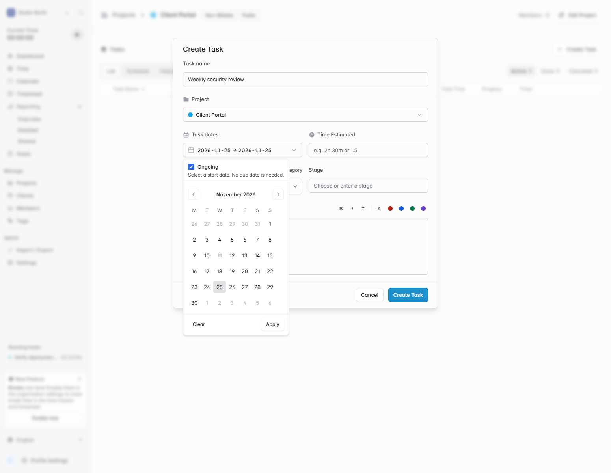
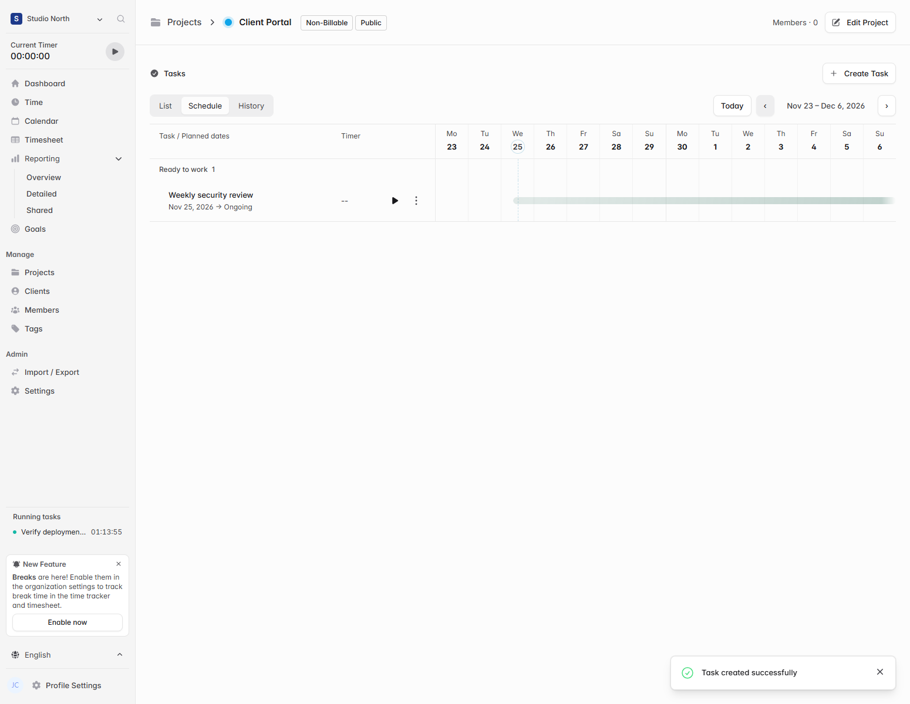

# Support ongoing task dates

## Why

Long-running responsibilities such as routine maintenance have a start date and may continue indefinitely. They need a place on the project schedule without an arbitrary deadline.

## Changes

- Choose **Ongoing** under **Task dates** and select a start date when creating or editing a task.
- Show the ongoing label in the task list and extend its Schedule bar into later weeks while the task stays active.
- Save ongoing dates using the existing start date and an empty due date. Users can switch back to a date range or clear the dates.

## Verification

Built the frontend and verified against the local Solidtime preview with sample data. Created an ongoing task from the form, checked its saved dates and cross-week Schedule bar, reopened the editor, cleared the dates, and verified bounded date and completion updates through the API.

## Screenshots

[Upstream Solidtime README](https://github.com/solidtime-io/solidtime#readme)
