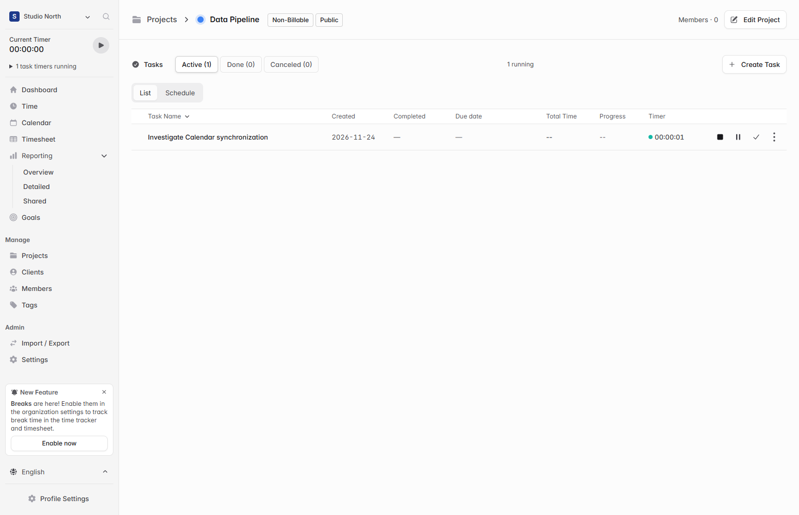
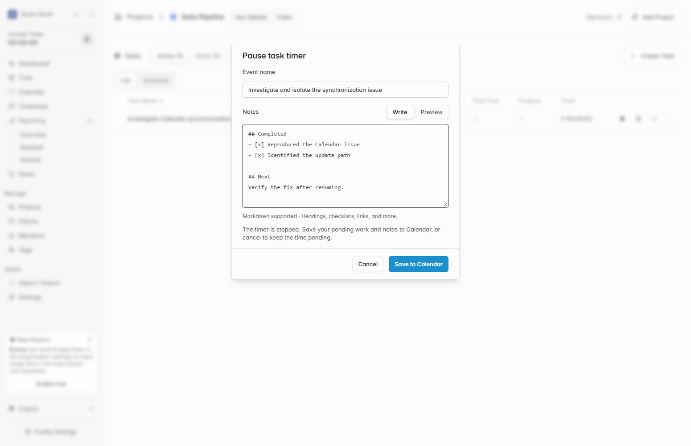

# Separate Stop from Pause in task timers

Stopping a timer currently opens the Calendar notes flow. A brief break should keep the tracked time pending, while an interruption should let the user describe the work and save it.

## Behavior

- **Stop** stops the clock immediately and retains pending timer segments. Resume continues the same task after the break.
- **Pause** stops the clock before opening the event-name and Markdown notes dialog. Saving creates Calendar entries for the pending work and keeps the task active.
- Canceling the notes dialog keeps the time stopped and pending. A failed save retains the entered notes for another attempt.
- Pending segments preserve gaps between work sessions. Each saved segment receives the event name and notes.
- **Complete** saves remaining pending work and marks the task as Done. Previously saved entries are retained.

## Verification

A local Edge browser using the real Solidtime API verified stopping without creating an entry, pending time after a page reload, resume, a stopped clock while writing notes, canceling the notes dialog, saving multiple segments with Markdown, handling a failed save, rejecting a stale retry, and completing the task without duplicating saved entries.

The production frontend build, TypeScript check, ESLint, and PHP formatting checks passed. The task timer endpoint suite passed against an isolated PostgreSQL database with 2 tests and 59 assertions, covering the new Stop flow and existing parallel timer behavior.

[Upstream Solidtime README](https://github.com/solidtime-io/solidtime#readme)