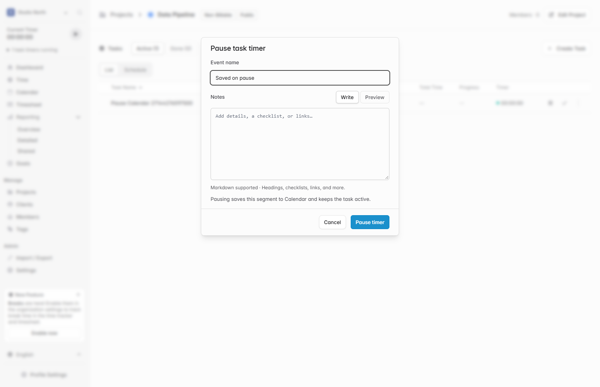

# Save paused task time to Calendar and sync task totals

Pausing a task timer saves the elapsed segment as a Calendar time entry and leaves the task active. The pause dialog accepts an event name and optional Markdown notes. Resuming starts a new segment, and completing the task saves any remaining unsaved time.

Editing the start or end of a linked Calendar entry updates the task's tracked total in the same request.

## Verification

The frontend build, TypeScript check, and local browser and API checks passed. I paused a task from its project page, verified the linked Calendar entry, changed its time range through the Calendar API, and confirmed that the task total updated immediately. I also verified that a stale pause request and later completion did not create duplicate entries.

[Upstream Solidtime README](https://github.com/solidtime-io/solidtime#readme)
