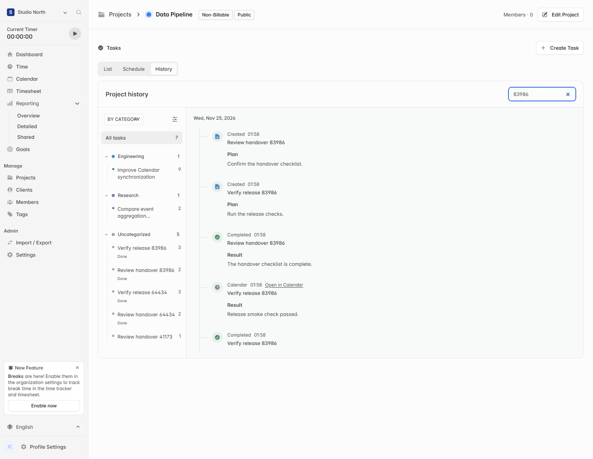

# Build project history from task and Calendar notes

Project History required users to create a separate record and enter a title for work they had already logged. This change shows their existing notes in chronological order under the task name.

- Write the plan when creating or editing a task. Record the result when marking it done, including when the task has no running timer.
- Complete a timed task with its existing name and an optional note. Pending work is saved to Calendar with the note. If there is no time to save, the completion note remains on the task.
- Project History shows task creation, completion and permitted Calendar entries, with links back to Calendar. Previously entered History notes remain visible.
- Remove the Markdown help sentence from the shared Notes field and keep Write and Preview.

## Verification

The frontend build and Vue type check passed. A browser check against the local sample database created tasks with Markdown notes, completed one directly and one through the timer, then reloaded History. Both notes appeared, and the timed note linked back to Calendar.

[Upstream project README](https://github.com/solidtime-io/solidtime/blob/main/README.md)
