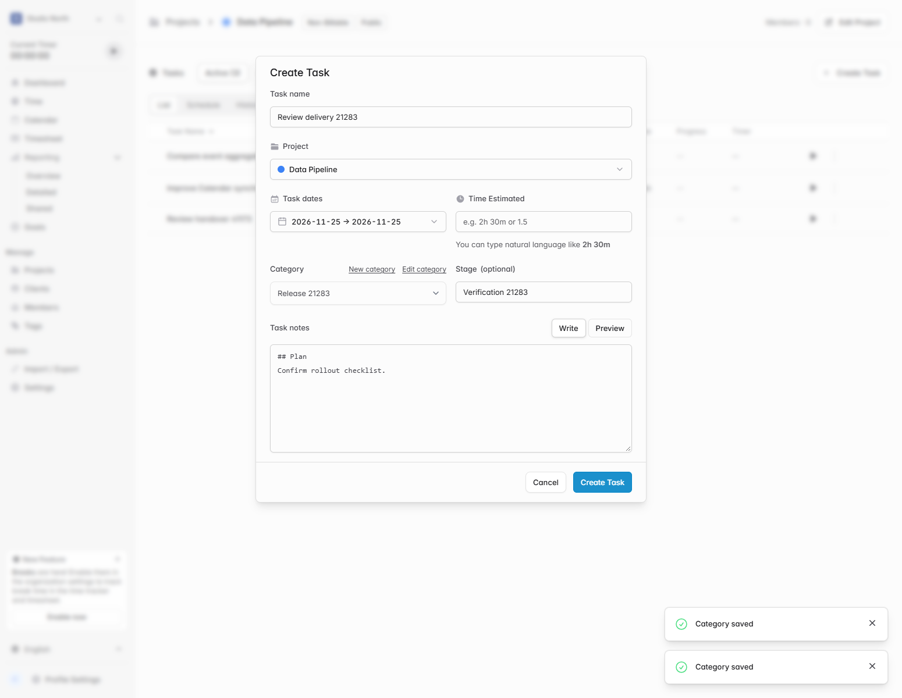
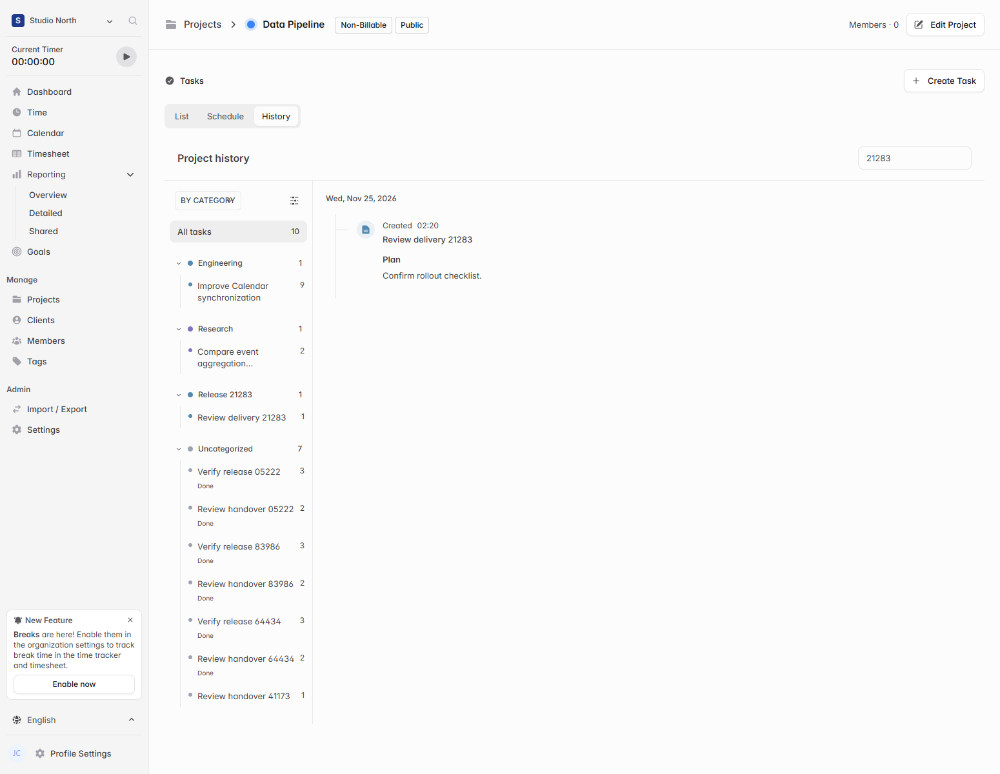

# Manage task categories from task forms

Task creation and editing now provide shortcuts to create a category or edit the selected one. Saving a category selects it on the current task form and preserves the draft. The Stage field suggests stages from the selected project and accepts a new or edited value for the current task.

Project History uses open edges and internal separators, matching the Tasks list.

## Verification

The Vue type check and frontend build passed. In the local browser, creating and renaming a category from the task form selected it automatically and preserved the draft. The saved stage appeared as a suggestion after reload. Project History rendered without an outer border and switched to a stacked layout at a narrow viewport.

[Upstream project README](https://github.com/solidtime-io/solidtime/blob/main/README.md)
