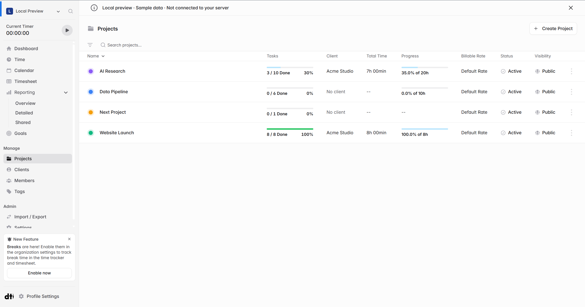

# Show completed task counts in the project list

When I look at the project list, I can see how many tasks each project has, **but I can’t tell how many are done or left**. For example, if I finish 3 out of 10 tasks, the list still shows “10 Tasks.” I have to open the project to see how much work is left.

I’d like to see “3 of 10 done” directly in the project list. I tried this locally with a separate Tasks column, as shown in the screenshot below.

Would you be open to a PR for this? I’d also be happy to show the count next to the project name if you prefer that layout.

[Solidtime project README](https://github.com/Utoria-wu/solidtime/blob/main/README.md)
