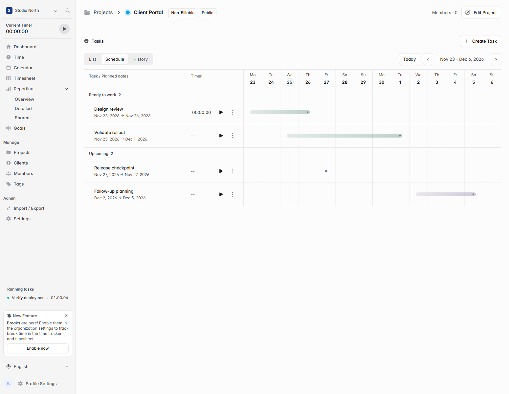
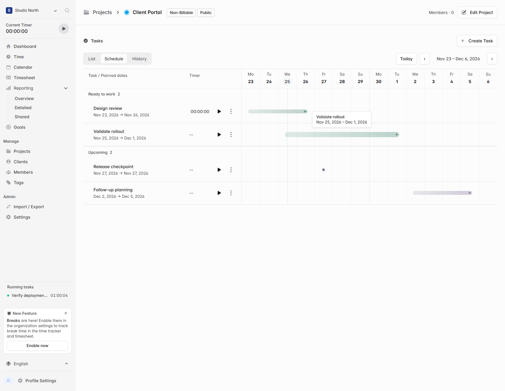
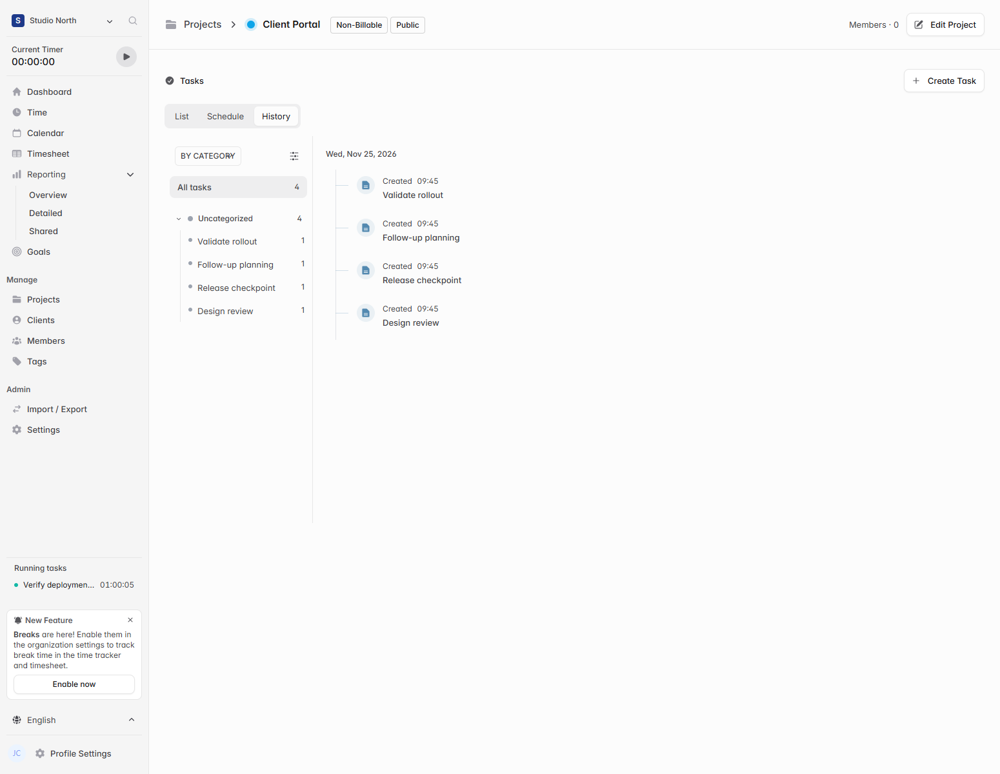

# Refine task schedule and history views

## Why

The two-week schedule used large background treatments that competed with task dates, and timeline markers offered little interaction. History also repeated the active view name above the timeline.

## Changes

- Show a fine day grid and mark today with an outlined date and a dashed guide.
- Use light gradient bars for date ranges and dots for single dates. Hover or focus a marker to see its dates. Click it or press Enter to open task details.
- Remove the History title and search row so the task groups and activity timeline begin directly under the view selector.
- Remove the persistent background from the running task's Stop button.

## Verification

Ran the production frontend build and checked the local preview with sample data. Verified the two-week schedule, tooltip, task details via mouse and keyboard, the cross-project schedule, History task selection, and the resting Stop button.

## Screenshots

[Upstream Solidtime README](https://github.com/solidtime-io/solidtime#readme)
