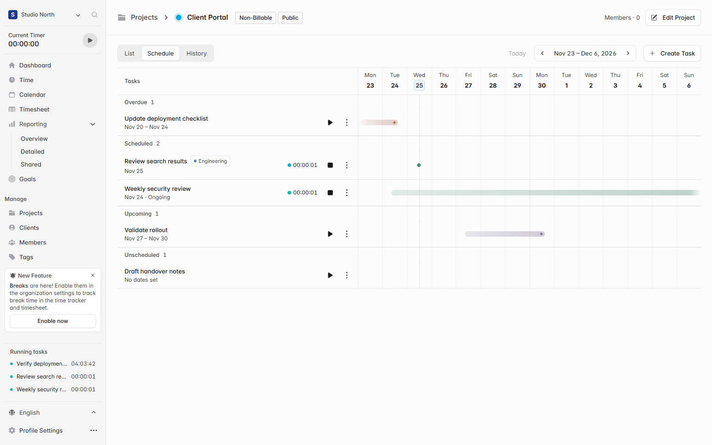
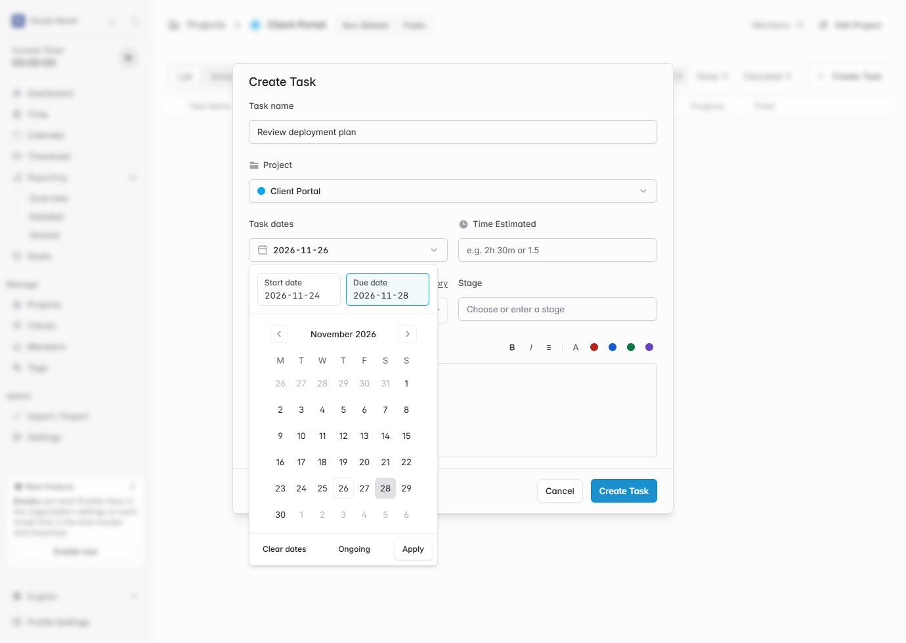
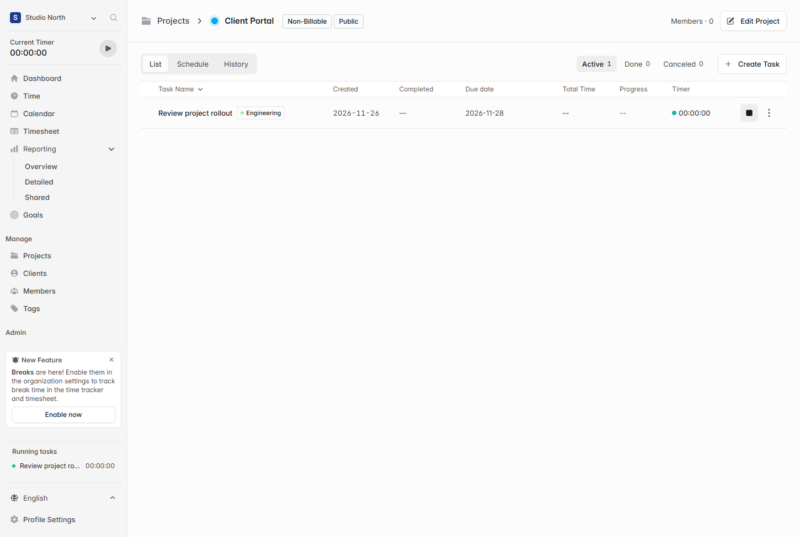
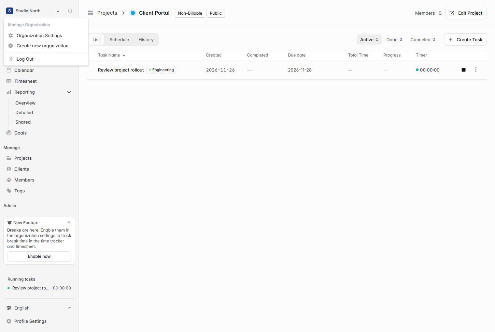

# Refine the project schedule, task dates, and sidebar

## Why

Project Schedule spread its controls across multiple rows, and the task form combined the two scheduling dates in a single field. Pale category colors made some labels hard to read. Running timers and account settings also needed clearer separation.

## Changes

- Place the view selector, date navigation, and Create Task on one toolbar. Show compact schedule dates and place elapsed time beside task controls.
- Use one Task dates popover with distinct Start date and Due date buttons, a shared calendar that outlines both endpoints, and one Apply action. Reject reversed dates before applying and keep the Ongoing option.
- Use the primary text color for category labels and preserve their colors as dots.
- Separate running timers from the language and profile settings. Move Log Out and Feedback to the organization menu.

## Verification

Built the frontend and ran Vue type checking. In the local preview, created and edited a sample task, checked the stored dates, verified the two endpoint outlines including same-day dates, keyboard switching, draft dismissal, narrow-screen layout, the invalid-range message and open-ended Schedule bar, and confirmed the organization menu actually signs out the preview account.

## Screenshots

[Upstream Solidtime README](https://github.com/solidtime-io/solidtime#readme)
