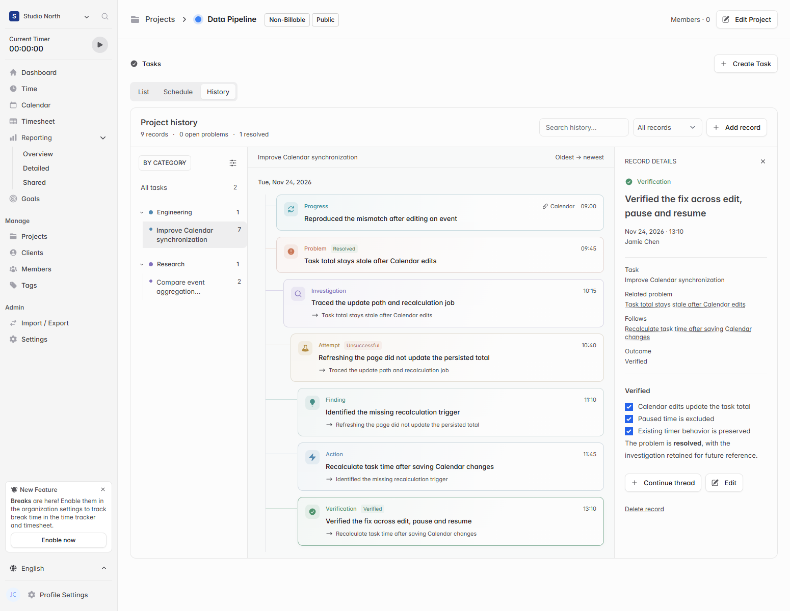
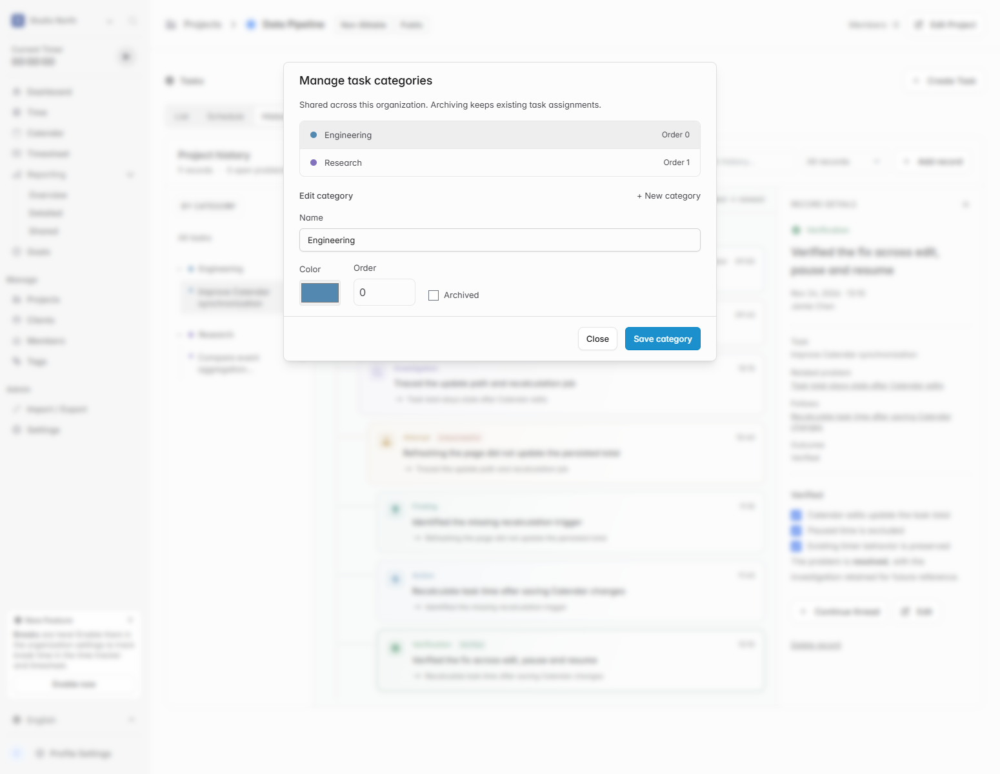

# Add project history and editable task categories

## Problem

A time entry explains when work happened, but it does not show how a task evolved: which problem appeared, what was investigated, which attempts failed, and how the result was verified. Task names and free-form Calendar notes are difficult to follow across multiple work sessions.

## Proposed change

Add a **History** view beside the existing task List and Schedule views on a project page. It connects task records into an explicit, chronological story while keeping the existing task and timer workflows available.

- Browse all project tasks, including completed and canceled tasks, grouped by category or optional stage.
- Create organization-wide categories with editable names, colors, display order, and archive status. Existing tasks stay uncategorized until assigned; archiving retains existing assignments.
- Capture Progress, Problem, Investigation, Attempt, Finding, Action, and Verification records with Markdown notes and an occurrence date.
- Follow a borderless timeline with thin connecting lines, indented branches, small circular icons, and subtle hover/selection feedback.
- Link a record to a problem and a preceding record within the same task. Mark unsuccessful attempts, resolved problems, and verified outcomes without overwriting the investigation.
- Link an accessible Calendar event, or explicitly copy its title, notes, and date into a new record. Existing Calendar notes are not automatically classified or rewritten.
- Search the timeline, filter open or resolved problems, and inspect the selected record, its relationships, and Calendar source.
- Edit or delete records with version checks. A record with dependent links must be relinked before deletion.

## Screenshots

Screenshots below are captured from the actual local application with sample data.

### Task explorer, investigation timeline, and record details

### Editable task categories

## Validation

Functional validation was performed locally on 2026-11-24 against an isolated PostgreSQL sample database. The borderless timeline styling was checked in the browser on 2026-11-25, including zero row borders/shadows and responsive screenshots.

- PostgreSQL migration applied successfully to a local preview database.
- PHP endpoint tests: **6 tests, 107 assertions passed**, covering category organization scoping, archive behavior, task field persistence, private-project and Calendar permissions, record relationships and chronology, version conflicts, dependent-record deletion, and existing Stop/Pause timer behavior.
- Vue TypeScript checks and the production frontend build passed.
- Endpoint command: `vendor/bin/phpunit --filter "TaskHistoryEndpointTest|TaskTimerEndpointTest" tests/Unit/Endpoint/Api/V1`.
- Real local browser checks covered category editing, record creation/editing/deletion, refresh persistence, open/resolved filtering, Markdown sanitization, the existing task List and Schedule views, and Start/Stop controls. Additional checks verified Continue thread links, category/stage assignment from the task form, failed-save draft retention, and the responsive mobile layout.

## Scope and compatibility

This adds task-category and history tables, plus nullable category and stage fields on tasks. History is explicit and user-authored; it does not infer causal relationships from old notes. Category management follows the existing tag-management permissions, history follows task permissions, and Calendar sources retain their existing access restrictions. No production database or deployment was changed for this preview.

[Upstream project README](https://github.com/solidtime-io/solidtime/blob/main/README.md)
