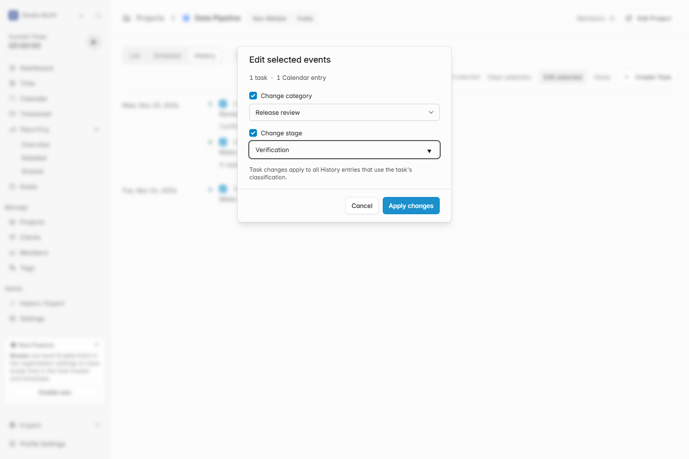
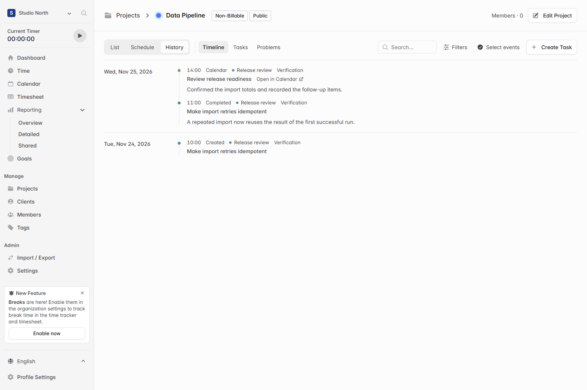
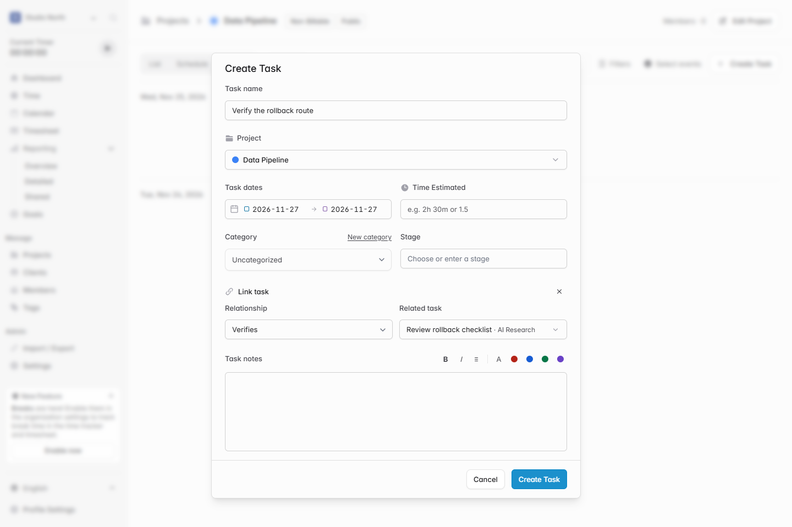
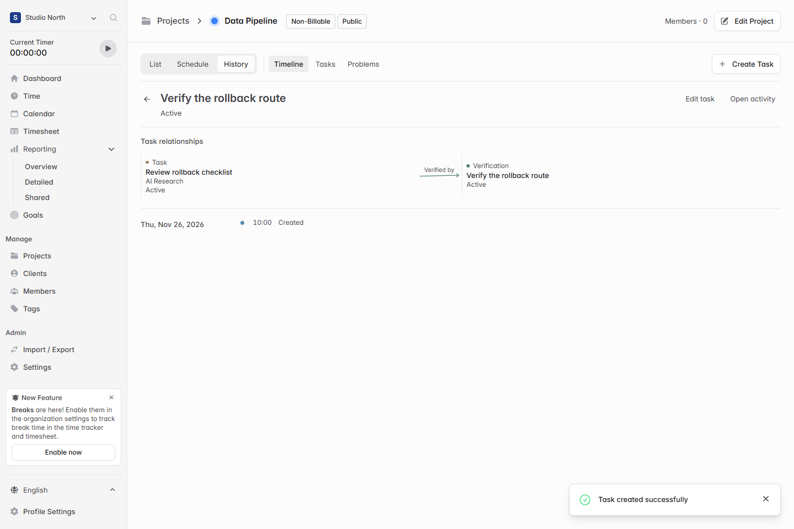

# Batch classification in Project History and cross-project task links

Organizing a project timeline can mean updating several related entries. The History timeline now supports selecting task events and standalone Calendar activity in a single batch.

When work spans projects, a task can link to related work during creation or later from the existing Link task action.

## What changes

- Choose **Select events**, select individual rows or all visible editable rows, and open **Edit selected**.
- Set or clear **Category** and **Stage** independently. Rows show their classification, and both fields can be used to filter the timeline.
- Task events share the task's classification. A Calendar entry can store its own classification whether it is linked to a task or stands alone.
- The server saves the batch in one transaction and checks that each entry belongs to the project and can be edited by the current user.
- The **Create Task** dialog offers an optional **Link task** section. A task and its initial link are saved together.
- The task picker searches by task and project name. It lists accessible projects in the current organization, and each project's History graph can open the linked task in the other project.

## Screenshots

## Verification

- The local browser preview used sample data and mocked API responses to exercise mixed selection, deduplication of task events, reload, the standalone Calendar filter, a failed save, and creating and following a cross-project link.
- Vite build, TypeScript checking, and the targeted History frontend tests passed.
- The endpoint tests use a local PostgreSQL database with sample data. They check classification and Calendar read-back, protected rows, cross-project relationships on both projects, cycle prevention, and atomic task creation.

[Upstream Solidtime README](https://github.com/solidtime-io/solidtime/blob/main/README.md)
