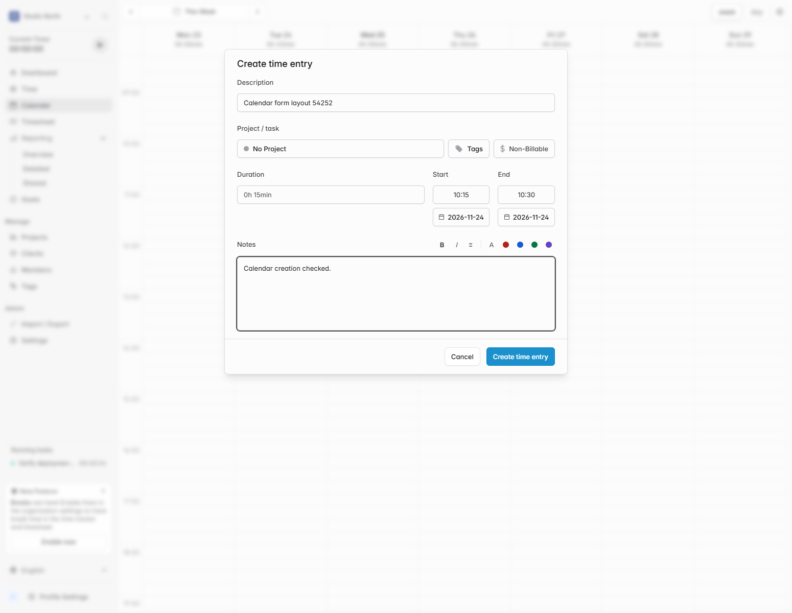
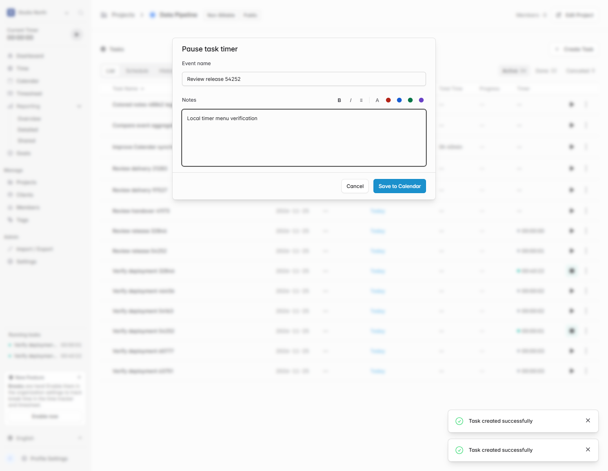
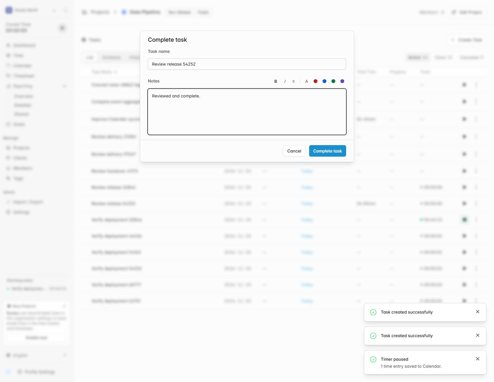
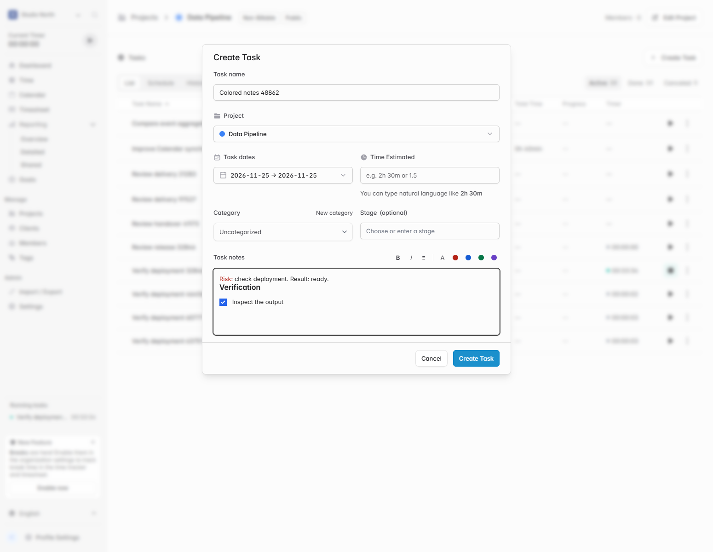
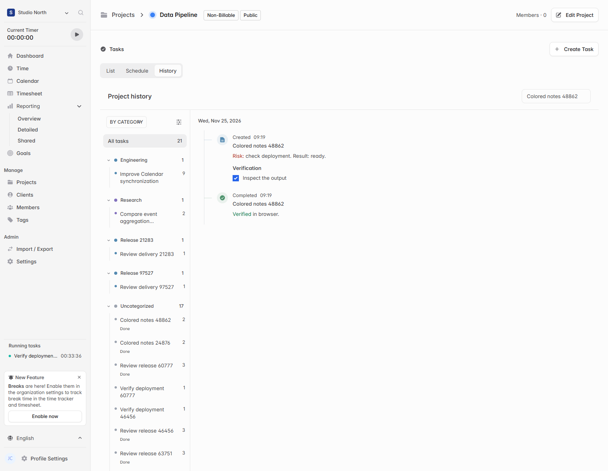
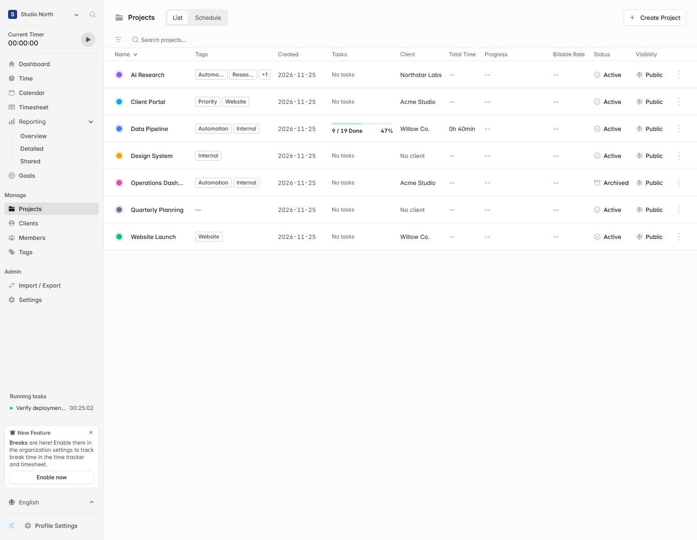
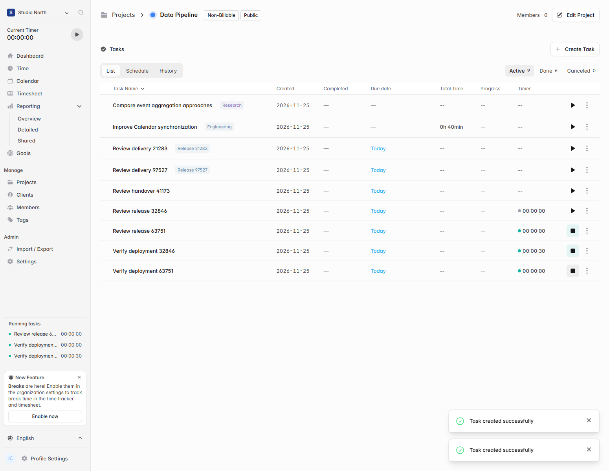

# Simplify project task and timer controls

Running task timers previously sat behind a collapsed row at the top of the sidebar. The project task toolbar also mixed view selection with status filters, and a running row exposed several equal-weight action buttons.

Running timers now appear in an expanded list below the sidebar navigation, with a task link and live duration. The project toolbar puts List, Schedule and History on the left and List status filters on the right. Schedule stays available when List is filtered to Done or Canceled. Each task row aligns a timer button and an actions menu. Pause and save to Calendar and Mark as done are available from that menu.

The Projects list puts tags in a dedicated column immediately before Created, keeping badges aligned across projects.

The shared Notes field provides a single live editing surface with basic formatting and a text color palette. History and task activity display the saved colors. Existing Markdown remains readable and pasted Markdown renders in the editor.

Calendar entry creation and task pause/completion use consistent dialog widths, form spacing, Notes controls and footer buttons. Task Stage is labeled simply “Stage” and can be left blank. Duration fields retain their existing input behavior with less help text.

## Verification

The Vue type check and frontend build passed. In the local browser, two concurrent timers appeared together without expanding the sidebar. Stop, Pause and save to Calendar, and Mark as done worked from the updated controls. Switching between List, Schedule, and History preserved the List status selection.

The Projects list was checked in the browser for tag alignment, Created sorting, and horizontal scrolling at a narrow width.

Local browser checks verified selected text color, reset to the default color, a Markdown heading and checklist, completion notes appearing in History after reload, and the pause-to-Calendar workflow. An older Markdown note still rendered, and unsupported colors and active HTML were removed.

The local browser successfully saved a Calendar entry, paused and saved a timer, and completed a task using the aligned forms. The existing Calendar form regression suite passed all 17 tests.

[Upstream project README](https://github.com/solidtime-io/solidtime/blob/main/README.md)
