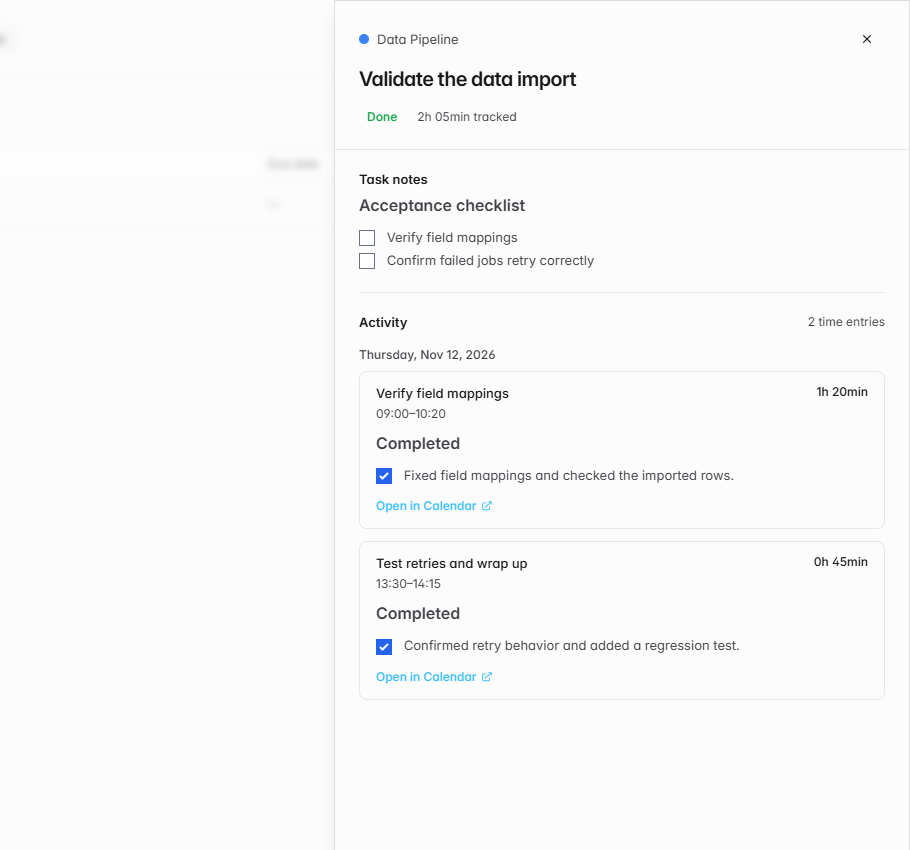

# View linked Calendar entries from a task

When I revisit a completed task, I want to see the work sessions that contributed to it and read the notes I recorded during each session.

Click a task name in Active or Done to open its details. Activity shows your linked Calendar entries in chronological order, with each entry's title, time range, duration, and Markdown notes. Open in Calendar jumps to the selected entry. If task notes are available, they appear above Activity.

The screenshot shows the companion task Markdown notes feature enabled in a local demo. I verified that the Activity branch works independently and that the combined preview shows both notes and the correct total for two entries. The Calendar link opened the selected entry and its saved notes.

[Solidtime project README](https://github.com/solidtime-io/solidtime/blob/main/README.md)
