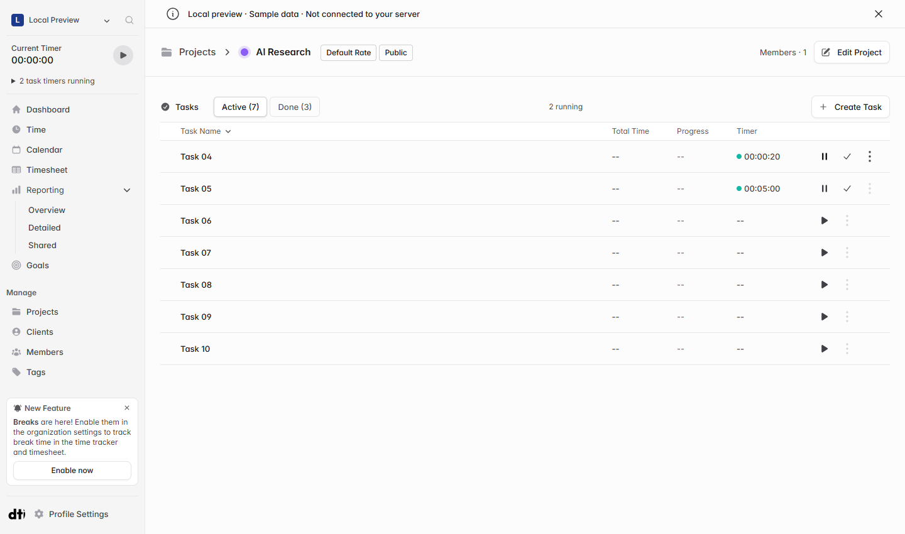
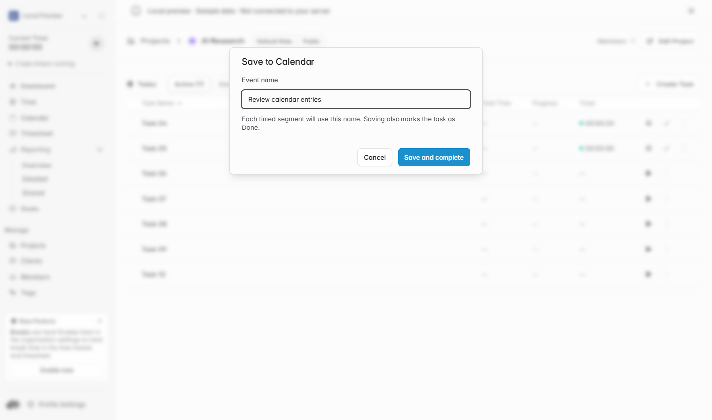

# Track multiple tasks in parallel from the project task list

When I run a long task in the background, such as a build or an AI job, I often start another task before it finishes. With one active timer, I have to stop the first timer or log the overlap by hand in Calendar.

Would you be open to adding independent timers to the project task list? I tried this in my self-hosted fork. Each task can be started, paused, or resumed on its own. Completing a task opens a dialog to name the Calendar event. Saving records each timed segment under that name, leaves out paused time, and moves the task to Done. Other timers keep running.

The prototype respects the organization’s setting for overlapping time entries. I’d like feedback on whether the project task list is the right place for these controls and how overlapping work should appear in Calendar and reports.

*Local preview with sample data.*

[Solidtime project README](https://github.com/Utoria-wu/solidtime/blob/main/README.md)
